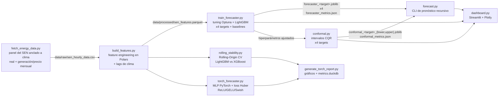

# ⚡ Pronóstico de la Red Eléctrica Chilena (SEN)

[[English](README.md) ] | [Español ]


Pronóstico horario multi-target del Sistema Eléctrico Nacional (SEN) de Chile — generación solar, generación eólica, demanda y costo marginal (precio spot) — para 5 nodos reales de 220kV, sobre un panel horario anclado al clima real (Open-Meteo/ERA5), la generación mensual real del SEN y el costo marginal real de Crucero, con modelos LightGBM ajustados vía Optuna, validados walk-forward contra baselines naive/estacional, features meteorológicas reales (radiación solar, viento, temperatura) que cierran la brecha causal entre el clima y la generación renovable, una comparación de estabilidad vía Rolling-Origin CV contra XGBoost, un motor de pronóstico recursivo multi-step, y un dashboard de monitoreo en Streamlit.

## 1. Contexto de negocio

El SEN chileno está dominado por energías renovables en sus nodos del norte (una de las mayores irradiancias solares del mundo, en el desierto de Atacama) y cada vez más por generación eólica en el sur. Esto genera una dinámica de mercado real y bien documentada: alta generación renovable en un nodo empuja su costo marginal hacia cero al desplazar generación térmica cara, mientras que un pico de demanda con baja generación renovable lo empuja fuertemente al alza. Pronosticar generación, demanda y precio con anticipación — a nivel de nodo, no solo a nivel de sistema — es lo que le permite a un generador, a un gran consumidor industrial (la minería es una carga relevante en el norte) o a un operador de mercado anticipar su exposición a costos y el riesgo de precios pico, en vez de reaccionar después de que ocurren. Pronosticar las cuatro series (no solo el precio) también importa operacionalmente: un operador de red que programa reservas necesita saber *cuánta* solar/eólica/demanda esperar, no solo cuánto va a costar.

## 1.1 Impacto de Negocio e Indicadores Clave (KPIs)

| Métrica | Resultado | Qué significa |
|---|---|---|
| WAPE de generación solar | **5,55%** (vs. 28,89% ingenuo, 10,71% estacional) | La nubosidad real vuelve la solar más difícil que en el simulador anterior, pero la estructura diurna sigue dando a LightGBM una ventaja 2x sobre el perfil de ayer |
| WAPE de demanda | **2,54%** (vs. 4,98% ingenuo) | La mitad del error de la persistencia de 1 hora |
| WAPE de costo marginal | **8,77%** (vs. 11,09% ingenuo) | Pronóstico de exposición a costos sobre precios cuyo nivel mensual es el costo marginal real de Crucero |
| Costo marginal, intervalo de predicción del 90% | **88,1% de cobertura empírica** (conformalizado) vs. 76,2% de los cuantiles crudos de LightGBM | Los cuantiles crudos fallan una hora de cada cuatro; conformalizar los acerca al nominal |
| Eólica | LightGBM 22,40% vs. ingenuo 23,29% | El viento real en estas subestaciones es débil e intermitente (generación cero entre 20% y 79% de las horas); la persistencia es una línea base difícil |
| Mejor modelo en precio | MLP en PyTorch, WAPE 7,83-8,73% vs. 10,07% de LightGBM con parámetros por defecto | Mismos folds y features; la red supera a ambos ensambles de árboles en este target |

## 2. Datos

**Qué es real y qué es simulado.** El Coordinador Eléctrico Nacional (CEN) publica el costo marginal horario por barra, pero su API exige una cuenta institucional y su sitio bloquea descargas automatizadas. Por eso este proyecto ancla un panel horario simulado a todas las series reales que *sí* se pueden descargar públicamente (`src/data/real_sources.py`, guardadas en `data/real/` para que el pipeline y los tests corran sin red):

| Serie | Fuente | Granularidad | Uso |
|---|---|---|---|
| Irradiancia solar (GHI), viento a 100 m, temperatura | Open-Meteo (reanálisis ERA5) en las coordenadas de cada subestación | Horaria, real | Reemplaza al clima simulado; la generación solar y eólica se derivan de ella |
| Generación bruta del SEN por tecnología (total, solar, eólica) | datos.gob.cl (CNE), por central | Mensual, real | Calibra la forma mensual de la solar, la eólica y la demanda |
| Costo marginal en Crucero 220 kV | Reportes mensuales de la CNE (extraídos en el gemelo SAG de este portafolio) | Mensual, real | Fija el nivel mensual del precio |
| Perfil horario de demanda, formación de precio, picos de precio | Simulador (`src/data/fetch_energy_data.py`) | Horaria, simulada | Completa lo que ninguna fuente pública entrega |

Es decir, el clima y la estacionalidad son reales; el precio y la demanda horarios se simulan *alrededor* de niveles mensuales reales. El precio promedio mensual de Crucero coincide con la cifra real de la CNE con menos de 1% de diferencia (lo fija `tests/test_real_sources.py`). `generate_energy_data(use_real=False)` sigue produciendo el panel original completamente simulado.

| Nodo | Ubicación | Perfil | Cap. solar (MWh) | Cap. eólica (MWh) | Demanda base (MWh) |
|---|---|---|---|---|---|
| Crucero_220kV | María Elena, Antofagasta | Minería (carga casi plana, 24/7) | 220 | 40 | 180 |
| Cardones_220kV | Copiapó, Atacama | Mixto | 200 | 60 | 90 |
| Quillota_220kV | Quillota, Valparaíso | Urbano (doble pico) | 110 | 70 | 140 |
| Alto_Jahuel_220kV | Buin, Metropolitana | Urbano (doble pico) | 130 | 30 | 320 |
| Charrua_220kV | Cabrero, Biobío | Industrial, alto viento | 70 | 140 | 150 |

Cómo se arma el panel:
- **Primero el clima, la generación se deriva de él.** La solar es una fracción lineal de la GHI real sobre el pico de cielo despejado de cada nodo; la eólica pasa por una curva de potencia de turbina (arranque 3 m/s, nominal 12,5 m/s) aplicada al viento real a 100 m. El viento real en Alto Jahuel, Cardones y Quillota promedia unos 2 m/s, bajo el arranque casi siempre, así que esos nodos no generan viento entre 72% y 79% de las horas, lo que es honesto: no hay parques eólicos en esas subestaciones.
- **Calibración mensual.** La solar, la eólica y la demanda se multiplican por un factor mensual que convierte la forma mensual del agregado de los cinco nodos en la forma mensual real del SEN, conservando el nivel promedio de cada nodo.
- **Demanda**: perfil horario por tipo de nodo, calendario de feriados chileno, tendencia de crecimiento y efecto de temperatura (climatización), ahora con temperatura real.
- **Costo marginal**: se deriva de la demanda residual (demanda menos solar y eólica) con lógica de orden de mérito, más picos ocasionales de estrés de oferta; se recalcula después de calibrar y luego se escala mes a mes al costo marginal real de Crucero. Los precios cercanos a cero con mucha solar son un fenómeno real del norte de Chile.

Los datos crudos y las features procesadas están en `.gitignore` y se regeneran a pedido; solo se versionan las series reales pequeñas de `data/real/` (ver [Cómo ejecutar](#8-cómo-ejecutar)).

## 3. Arquitectura



## 4. Metodología

**Feature engineering** (`src/features/build_features.py`, Polars, calculado **por nodo** vía `.over("node")` para que filas de distintas barras nunca se mezclen dentro de una misma ventana):
- Lags de 1h, 24h y 168h (1 semana) para solar, eólica, demanda y precio.
- **Lags meteorológicos** de 1h, 3h, 6h y 24h para `ghi_w_m2` (irradiancia solar), `wind_speed_ms` y `temperature_c` (`add_weather_lag_features`) — horizontes más cortos que los de los targets, porque el clima se autocorrelaciona y decae más rápido hora a hora que un patrón semanal de demanda, así que un lag de 168h aportaría poco. Igual que con los 4 targets, el valor crudo de la misma hora se excluye del set de features (`get_feature_columns`) — solo se usan lags, porque este proyecto simula observaciones históricas, no un pronóstico NWP que legítimamente conocería el clima de horas futuras por adelantado.
- Media y desvío móvil sobre ventanas de 6h y 24h — calculados sobre `shift(1)` para que la ventana nunca incluya la fila que se está prediciendo.
- Codificación cíclica seno/coseno de hora del día y mes, evitando el salto artificial 23→0 / dic→ene de un entero directo.
- Features de calendario: día de la semana, indicador de fin de semana, y feriados legales chilenos (incluyendo feriados móviles como Viernes Santo, vía la librería `holidays`).

**Modelo, tuning y validación** (`src/models/train_forecaster.py`): un `LGBMRegressor` por target — solar, eólica, demanda y precio comparten exactamente el mismo set de features (los valores crudos de la misma hora de los 4 targets, más las 3 variables meteorológicas crudas, siempre se excluyen; en un despliegue real tampoco se conocería la demanda o generación actual con certeza, solo sus lags y estadísticas móviles). Para cada target, **Optuna** (`tune_hyperparameters`) busca learning rate, profundidad/hojas del árbol, submuestreo y regularización L1/L2 sobre 20 trials, minimizando el WAPE walk-forward en 3 folds; los mejores hiperparámetros se re-validan luego con un pase completo de 5 folds walk-forward para el reporte final.

La validación usa `TimeSeriesSplit` aplicado sobre **timestamps únicos** (`src/models/validation.py`), no sobre las filas crudas del panel — con 5 nodos compartiendo cada hora, dividir solo por orden de fila podría dejar la hora *t* de un nodo en entrenamiento mientras la hora *t-1* de otro nodo cae en test, lo cual sigue siendo lookahead bias aunque el índice de fila sea "posterior". Dividir sobre el eje temporal mueve los datos de todos los nodos de un mismo bloque de tiempo juntos. Los baselines (`src/models/baselines.py`) se evalúan sobre exactamente los mismos folds y la misma métrica WAPE, así que la comparación LightGBM-vs-baseline de abajo es directa y honesta.

**Rolling-Origin CV** (`src/models/rolling_stability.py`, `validation.get_rolling_origin_folds`): una segunda estrategia de validación, distinta del walk-forward expansivo de arriba. Cada fold entrena sobre una ventana de tamaño **fijo** (180 días por defecto) y evalúa sobre los 14 días siguientes, deslizándose hacia adelante — a diferencia del walk-forward expansivo (donde el train set de cada fold sigue creciendo), acá todos los folds ven la misma cantidad de historia reciente. Eso aísla específicamente la **estabilidad temporal**: si el error de un modelo varía mucho fold a fold con un tamaño de ventana de entrenamiento constante, eso es evidencia de inestabilidad real, no solo de que "el fold tardío tenía más datos". Se usa para comparar LightGBM contra **XGBoost** (listado en `requirements.txt` desde el inicio del proyecto pero nunca usado en ningún lado hasta ahora) vía el coeficiente de variación (CV = desvío/media) del WAPE entre folds de cada modelo — ver §5.3.

El error se reporta como **WAPE** (Weighted Absolute Percentage Error: `sum(|error|) / sum(|real|)`) en vez de MAPE, porque `solar_generation_mwh` es exactamente 0 todas las noches, lo que haría indefinido un error porcentual punto a punto en cada hora nocturna.

**Pronóstico multi-step hacia adelante** (`src/models/forecast.py`): predice recursivamente N horas hacia adelante por nodo. Como los 4 targets comparten un mismo set de features construido solo con lags/estadísticas móviles (nunca valores de la misma hora), un solo vector de features por hora futura alcanza para predecir los 4 a la vez — no hace falta decidir "cuál target pronosticar primero". Cada hora predicha se retroalimenta al buffer de historia antes de avanzar a la siguiente, exactamente como funcionaría en producción, donde el futuro real todavía no existe.

## 5. Resultados

### 5.1 Validación walk-forward: LightGBM (ajustado con Optuna, con clima) vs. baselines

Validación walk-forward, 5 folds cada uno, 48 features compartidas, LightGBM (ajustado con Optuna) vs. dos baselines evaluados sobre los mismos folds — **ingenuo** (persistir el valor de 1 hora atrás) y **estacional** (la misma hora 24 horas atrás). En negrita, el mejor de los tres por fila:

| Target | WAPE LightGBM | WAPE ingenuo | WAPE estacional | MAE LightGBM |
|---|---|---|---|---|
| Generación solar | **5,55%** | 28,89% | 10,71% | 2,01 MWh |
| Generación eólica | **22,40%** | 23,29% | 82,74% | 2,17 MWh |
| Demanda | **2,54%** | 4,98% | 5,67% | 4,21 MWh |
| Costo marginal | **8,77%** | 11,09% | 11,71% | $5,73/MWh |

Todos los números salen de correr `python -m src.models.train_forecaster` de punta a punta sobre el panel anclado al clima real (semilla 42, 87.720 filas sobre 5 nodos × 17.544 horas, 20 trials de Optuna por target). LightGBM le gana a ambas líneas base en todos los targets.

**Qué cambió con el clima real.** Con el clima simulado anterior, la solar daba 3,64% y la persistencia le ganaba a LightGBM en eólica (9,93% vs. 10,31%). Con clima real, la solar es más difícil (5,55%) porque la nubosidad real es menos predecible que el sorteo diario de nubes del simulador, y la línea base estacional mejora mucho (19,46% → 10,71%) porque los días despejados reales del desierto de Atacama se repiten casi idénticos de un día al siguiente. La eólica va en sentido contrario: el viento real en estas subestaciones es débil y muchas veces queda bajo el arranque de la turbina, así que la generación es cero durante tramos largos y su WAPE es alto (22-23%) para todos los modelos, pero ahora LightGBM le gana por poco a la persistencia.

### 5.2 Aislando el efecto real del clima: una ablación controlada (`notebooks/02_Weather_Augmented_Rolling_CV.ipynb`)

El notebook aísla las features de clima manteniendo los hiperparámetros **fijos** en una comparación con/sin clima:

| Target | WAPE sin clima | WAPE con clima | Delta |
|---|---|---|---|
| Generación solar | 5,98% | 5,69% | **+0,29 pts** |
| Generación eólica | 23,24% | 22,69% | **+0,54 pts** |
| Demanda | 2,56% | 2,55% | +0,01 pts |
| Costo marginal | 9,82% | 10,07% | −0,25 pts |

**Con clima real, los rezagos de clima ayudan a ambas renovables.** La solar gana 0,29 puntos y la eólica 0,54, donde el simulador no le daba nada a la eólica (+0,003). El viento real no es una función determinista de su propia generación pasada, así que el viento rezagado aporta información que los rezagos de generación no tienen. La demanda no cambia, y el precio empeora levemente con las features adicionales sin reajustar, un efecto conocido de agregar dimensiones sin ajustar la regularización.

### 5.3 Rolling-Origin CV: estabilidad temporal de LightGBM vs. XGBoost

8 folds, ventana de entrenamiento fija de 180 días / ventana de test de 14 días, deslizándose (`src/models/rolling_stability.py`):

| Target | WAPE medio LightGBM (CV) | WAPE medio XGBoost (CV) |
|---|---|---|
| Solar | 5,02% (0,204) | 5,14% (0,202) |
| Eólica | 24,33% (0,206) | 24,81% (0,215) |
| Demanda | 2,56% (0,046) | 2,60% (0,063) |
| Costo marginal | **7,58% (0,084)** | 8,39% (0,111) |

CV = coeficiente de variación (desvío/media) del WAPE por fold; más bajo es más estable entre bloques de tiempo. LightGBM es al menos tan bueno como XGBoost en todos los targets, y en costo marginal es más preciso (7,58% vs. 8,39%) y más estable (CV 0,084 vs. 0,111, cerca de 1,3x). Con el panel simulado anterior la brecha de estabilidad en precio era 2,6x; con niveles mensuales reales de precio ambos modelos enfrentan las mismas oscilaciones reales y la brecha se achica. La variación entre folds de la solar (CV 0,20) es ahora mucho mayor que antes (0,10) para ambos modelos: las semanas nubladas y despejadas reales difieren mucho más que las simuladas.

El panel histórico del dashboard de Streamlit muestra precio real vs. pronosticado sobre el test out-of-sample del último fold — predicciones genuinamente fuera de muestra — y un panel separado ejecuta el pronosticador recursivo multi-step sobre horas que no existen en el dataset.

### 5.4 Un tercer enfoque de modelado: MLP en PyTorch vs. LightGBM/XGBoost, y ReLU vs. GELU vs. Swish

`src/models/torch_forecaster.py` agrega un tercer enfoque, arquitectónicamente distinto, sobre las líneas base estadísticas (§5.1) y los dos ensambles de árboles (§5.1/§5.3): un MLP denso (dos capas ocultas, 64→32 unidades) sobre exactamente el mismo conjunto de features de rezagos/ventanas que usan los árboles — mismos folds walk-forward (`validation.get_walk_forward_folds`), misma métrica WAPE/MAE, así que la comparación es directa. Dos cosas que este modelo agrega y los árboles no tienen:

- **Una loss Huber custom** (`torch_forecaster.huber_loss`, cuadrática para residuos chicos, lineal sobre `delta=1.0`), más robusta a los picos de precio por estrés de oferta de `marginal_cost_usd_mwh` que el objetivo tipo MSE que usan por defecto `LGBMRegressor`/`XGBRegressor`.
- **Una comparación controlada de activaciones** — ReLU, GELU y Swish (`nn.SiLU`), con arquitectura/optimizador/semilla fijos para que lo único que cambie entre corridas sea la no linealidad (`compare_activations`).

Validación walk-forward, 5 folds, target `marginal_cost_usd_mwh` (`python -m src.models.generate_torch_report`, corrida real, semilla 42, CPU; las filas de árboles usan parámetros por defecto fijos, no los ajustados con Optuna de §5.1):

| Modelo | WAPE | MAE | Latencia de inferencia (ms / 1k filas) |
|---|---|---|---|
| Ingenuo (persistencia 1h) | 11,09% | $7,23/MWh | -- |
| Estacional (persistencia 24h) | 11,71% | $7,66/MWh | -- |
| LightGBM (parámetros por defecto) | 10,07% | $6,61/MWh | -- |
| XGBoost | 10,83% | $7,11/MWh | -- |
| MLP PyTorch — ReLU | **7,83%** | **$5,07/MWh** | 0,50 |
| MLP PyTorch — GELU | 8,73% | $5,63/MWh | 0,50 |
| MLP PyTorch — Swish (elegida en validación) | 8,39% | $5,41/MWh | 0,51 |

**El MLP de PyTorch supera a ambos ensambles de árboles con las tres activaciones**, y también al LightGBM ajustado con Optuna de §5.1 (8,77%). Swish es la activación elegida por la loss de validación; ReLU resulta la mejor en test. La diferencia entre ambas (0,56 puntos) recuerda que la elección de activación es ruidosa a esta escala. Las métricas/predicciones se persisten en `data/processed/metrics.duckdb` (tabla `model_comparison`) junto al detalle por fold en `torch_forecaster_metrics.json`; los gráficos explicativos se guardan en `data/processed/torch_*.png`.

**Protocolo de entrenamiento.** Dentro de cada fold walk-forward, el último 15% de las horas de train (todos los nodos a la vez) se reserva como validación; las horas de test del fold no se tocan hasta la evaluación. Cada red entrena al menos 100 épocas (máximo 300) y desde ahí early stopping corta tras 20 épocas sin mejora en la loss de validación y restaura los pesos de la mejor época; la tasa de aprendizaje baja a la mitad cuando se estanca. El estado completo se guarda en un checkpoint cada época (`data/checkpoints/`), así que una corrida interrumpida retoma donde quedó y el script del GIF reutiliza los checkpoints del reporte en vez de reentrenar. La activación se elige con la loss de validación, no con el WAPE de test. La loss de validación toca su mínimo antes de la época 100 en 14 de las 15 corridas, así que casi todas se detienen justo después del mínimo y devuelven los pesos de una época anterior.

El GIF de abajo reproduce la loss Huber real por época de la corrida Swish, con una etiqueta flotante que muestra el valor actual de train/val a medida que avanza la línea.


### 5.5 Intervalos de predicción: Conformalized Quantile Regression (`src/models/conformal.py`)

§5.1–§5.4 son todos pronósticos puntuales. Una banda de riesgo es lo que se usa para dimensionar exposición, así que esto agrega una: un par de regresores de cuantiles LightGBM (percentil 5/95, apuntando a un intervalo nominal del 90%) por target, conformalizados con Conformalized Quantile Regression (Romano, Patterson & Candès, 2019) — un tramo de calibración tomado del último 15% del train de cada fold walk-forward (`_split_train_calibration`). Los hiperparámetros son los que Optuna ya ajustó para el modelo puntual, fijos; solo cambia la función de pérdida.

Cada fold reporta la cobertura **antes y después** de la corrección conforme:

| Target | Cobertura cuantiles crudos | Cobertura conforme | Nominal | Ancho crudo | Ancho conforme |
|---|---|---|---|---|---|
| Generación solar | 87,1% | 88,8% | 90% | 9,01 MWh | 9,26 MWh |
| Generación eólica | 85,0% | 88,3% | 90% | 8,31 MWh | 8,37 MWh |
| Demanda | 83,3% | 89,9% | 90% | 16,25 MWh | 18,80 MWh |
| Costo marginal | 76,2% | **88,1%** | 90% | 19,36 $/MWh | 29,69 $/MWh |

**Los regresores de cuantiles crudos subcubren en todos los targets, peor en precio (76,2%), y conformalizar cierra la mayor parte de la brecha.** La cobertura del precio sube de 76,2% a 88,1%, a costa de una banda más ancha (19,4 → 29,7 $/MWh): las oscilaciones mensuales reales del precio hacen su distribución más difícil de acotar que la del simulador anterior, y el margen de calibración tiene que absorberlo.

**El intervalo solar sigue mal calibrado dentro del día.** En el modelo desplegado (último fold), las horas de noche (`solar_generation_mwh == 0`, 42% de las filas) se cubren el 98,4% de las veces con un ancho medio de 0,08 MWh, mientras las horas de día se cubren solo el 68,0% de las veces con un ancho medio de 14,4 MWh. Un único margen escalar calibrado sobre ambos regímenes queda demasiado ancho para el que no tiene varianza y demasiado angosto para el que sí la tiene — una limitación de esta formulación de CQR con margen global sobre un target con muchos ceros, y la nubosidad real vuelve el régimen diurno más difícil que antes. Una calibración agrupada por día/noche o ponderada localmente sería la corrección natural; no está implementada.

**Cruce de cuantiles.** Los dos regresores de cuantiles se entrenan por separado, así que nada impide que se crucen (`lower > upper`) en una fila; ocurre en el 0,79% de las filas de test del modelo solar desplegado, concentradas al amanecer y al atardecer cerca del piso de 0 MWh. `rectify_crossing` (`src/models/conformal.py`) aplica la corrección estándar — mínimo/máximo elemento a elemento, según Chernozhukov, Fernández-Val & Galichon (2010) — en todo lugar donde se arma o evalúa un intervalo; `tests/test_forecast.py::test_forecast_intervals_are_never_crossed` lo fija contra la salida recursiva real de `forecast_node`.

El pronosticador recursivo de `forecast.py` y el panel de pronóstico futuro del dashboard toman estos intervalos automáticamente cuando se corrió `conformal.py` (`load_interval_models`); si no, ambos entregan solo el pronóstico puntual. El intervalo de cada paso recursivo se calcula desde el vector de features de ese paso pero nunca se reinyecta en el historial, así que no acumula incertidumbre a lo largo del horizonte — una simplificación conocida.

Corre `python -m src.models.conformal` después de `train_forecaster.py` (reutiliza los hiperparámetros ajustados de `forecaster_metrics.json`).

## 6. Ejemplo de pronóstico multi-step

```bash
python -m src.models.forecast --horizon 12 --nodes Crucero_220kV
```

Salida real (nodo de perfil minero, pronóstico desde la medianoche local del 2026-01-01): la generación solar se mantiene en cero hasta el amanecer y sube a 144,8 MWh a las 11:00, y el costo marginal baja de $61,8/MWh a medianoche a $37,2/MWh a las 11:00 a medida que la solar desplaza generación cara — la dinámica de orden de mérito, recuperada de las propias predicciones recursivas del modelo. La eólica baja de 16,3 a cerca de 5 MWh durante la noche, siguiendo sus rezagos recientes.

**Una limitación que expone la propia salida del pronosticador recursivo**: `forecast.py` persiste los últimos valores de clima *conocidos* hacia las horas futuras (ver `forecast_node`, `last_known_weather`), porque el proyecto usa observaciones históricas de clima, no un pronóstico NWP de horas futuras. La solar igual evoluciona bien porque su driver dominante (la codificación cíclica de hora/mes) se recalcula para cada timestamp futuro, pero la eólica solo sigue sus propios rezagos. Un despliegue en producción necesitaría pronósticos NWP reales para el horizonte recursivo.

## 7. Stack tecnológico

Python · Polars · pandas · NumPy · LightGBM (regresión puntual + de cuantiles) · XGBoost · **PyTorch** (MLP, loss Huber custom, ReLU/GELU/Swish) · **Conformalized Quantile Regression** (intervalos de predicción) · **DuckDB** (almacén comparativo de métricas) · Optuna · scikit-learn (`TimeSeriesSplit`) · Streamlit · Plotly · `holidays` · Jupyter/matplotlib (2 notebooks) · pytest (53 tests: chequeos de fuga de features, correctitud de lags meteorológicos, invariantes de partición de folds tanto para walk-forward como Rolling-Origin CV, corrección de baselines, validación end-to-end del pronóstico recursivo, invariantes de cobertura/cruce/split de calibración conformal, smoke test del dashboard vía `streamlit.testing.v1.AppTest`, tests del MLP PyTorch/loss Huber/comparación de activaciones, round-trip del almacén de métricas DuckDB)

## 8. Cómo ejecutar

```bash
python -m venv venv
venv\Scripts\activate          # Windows
pip install -r requirements.txt

python -m src.data.fetch_energy_data      # armar el panel del SEN desde las series reales de data/real/ (targets + clima)
# python -m src.data.real_sources         # opcional: volver a descargar las series reales (Open-Meteo, datos.gob.cl)
python -m src.features.build_features     # construir features de lag/rolling/cíclicas/clima
python -m src.models.train_forecaster      # tuning Optuna + entrenar/validar walk-forward, los 4 targets
# opcional: --trials N (default 20) --splits N (default 5)

python -m src.models.rolling_stability     # Rolling-Origin CV, LightGBM vs XGBoost, los 4 targets

python -m src.models.generate_torch_report  # MLP PyTorch (loss Huber, ReLU/GELU/Swish) vs LightGBM/XGBoost
                                             # -> gráficos + data/processed/metrics.duckdb

python -m src.models.conformal              # intervalos de predicción CQR, los 4 targets (necesita train_forecaster antes)
# opcional: --splits N (default 5)

python -m src.models.forecast --horizon 24 --nodes all   # pronóstico recursivo a N horas (CLI)
                                                           # agrega columnas <target>_lower/_upper si conformal.py ya corrió
streamlit run src/app/dashboard.py                        # levantar el dashboard de monitoreo

python -m pytest tests/ -v                                 # correr la suite de tests

jupyter nbconvert --to notebook --execute --inplace notebooks/01_eda_seasonality_analysis.ipynb
jupyter nbconvert --to notebook --execute --inplace notebooks/02_Weather_Augmented_Rolling_CV.ipynb
```

## 9. Estructura del proyecto

```
src/
  data/       fetch_energy_data.py    panel horario del SEN anclado a datos reales (el simulador queda como use_real=False)
              real_sources.py         clima real (Open-Meteo), generación mensual del SEN, costo marginal de Crucero
  features/   build_features.py       features de lag/rolling/cíclicas/calendario/lags de clima en Polars
  models/     validation.py           folds walk-forward + folds Rolling-Origin + métrica WAPE
              baselines.py            métricas de referencia naive / estacional
              train_forecaster.py     tuning Optuna + LightGBM, 4 targets
              rolling_stability.py    Rolling-Origin CV, estabilidad temporal LightGBM vs XGBoost
              torch_forecaster.py     MLP PyTorch, loss Huber custom, comparación ReLU/GELU/Swish
              torch_plots.py          gráficos de predicho-vs-real / residuos / loss-por-época / activaciones
              metrics_db.py           almacén comparativo de métricas en DuckDB (tabla model_comparison)
              generate_torch_report.py  orquesta entrenamiento MLP + gráficos + persistencia DuckDB
              conformal.py            intervalos de predicción CQR (regresores de cuantiles + calibración), 4 targets
              forecast.py             CLI de pronóstico recursivo multi-step, con intervalos de predicción opcionales
  app/        dashboard.py            dashboard de monitoreo + pronóstico en vivo, en Streamlit, con banda de intervalo
notebooks/    01_eda_seasonality_analysis.ipynb       EDA: estacionalidad diurna/mensual, perfiles de demanda
                                                       por nodo, curva de pato, correlaciones clima-target,
                                                       autocorrelación en los lags que usa build_features.py
              02_Weather_Augmented_Rolling_CV.ipynb   ablación de features de clima + análisis de estabilidad
tests/                                pytest: features, validación, baselines, forecast, dashboard,
                                       estabilidad rolling, exclusión de columnas de features, cobertura/cruce/
                                       split de calibración conformal, MLP PyTorch/loss/activaciones,
                                       almacén de métricas DuckDB
```

## 10. Autor

**Pablo Reyes** — [github.com/Rxyxs](https://github.com/Rxyxs)
Código: MIT — ver [LICENSE](LICENSE)
