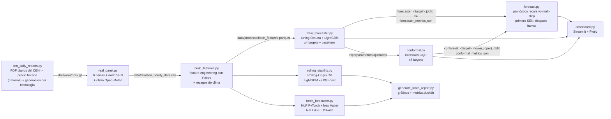

# ⚡ Pronóstico de la Red Eléctrica Chilena (SEN)

[[English](README.md) ] | [Español ]


Pronóstico horario del Sistema Eléctrico Nacional (SEN) de Chile sobre **cuatro años de datos horarios reales (2022-2025)**: el costo marginal de 6 barras reales de 220 kV, de Antofagasta a Puerto Montt, y la generación solar, la generación eólica y la demanda del sistema completo. Las series horarias no vienen de una API (la del Coordinador exige una cuenta institucional): se leen de los gráficos vectoriales de sus informes diarios públicos en PDF, se calibran día a día contra los números que imprime cada informe y se validan contra dos series mensuales oficiales independientes. Encima de eso: LightGBM ajustado con Optuna y validado walk-forward contra baselines ingenuos, variables de clima reales (ERA5), Rolling-Origin CV contra XGBoost, una MLP en PyTorch, intervalos de predicción conformales, un pronóstico recursivo multi-step y un dashboard en Streamlit.

## 1. Contexto de negocio

El SEN es una línea de 3.000 km. El norte (Atacama) tiene de las radiaciones solares más altas del mundo; el sur tiene hidro y viento; la transmisión entre ambos es limitada. Eso crea una dinámica de mercado real y documentada: a mediodía el excedente solar del norte lleva su costo marginal a cero mientras las barras más al sur siguen pagando térmica e hidro, y en la tarde el precio salta en todas partes cuando se pone el sol. Pronosticar el precio **por barra**, no un único precio del sistema, es lo que permite a un generador, a un gran consumidor industrial (la minería es una carga mayor en el norte) o a un trader anticipar su exposición de costo. Pronosticar la solar, la eólica y la demanda del sistema importa por sí mismo para programar reservas, y además alimenta el modelo de precio.

## 1.1 Resultados clave

| Métrica | Resultado | Qué significa |
|---|---|---|
| Series horarias reconstruidas de los gráficos del PDF | **1.394 días** con las 6 barras; residuo mediano de calibración **0,04 USD/MWh** | El gráfico de cada día se calibra contra los promedios diarios impresos en el mismo informe |
| WAPE de la demanda (sistema) | **1,20%** vs. 2,50% del ingenuo | La mitad del error de la persistencia de 1 hora |
| WAPE de la solar (sistema) | **6,21%** vs. 22,03% del ingenuo, 11,22% la misma hora de ayer | La hora del día y el clima explican la mayor parte |
| WAPE de la eólica (sistema) | **9,05%** vs. 11,80% del ingenuo | La persistencia es un baseline difícil para el viento |
| WAPE del costo marginal, 6 barras | **18,84%** vs. 21,87% del ingenuo | Los precios reales son mucho más difíciles que los del panel simulado anterior (8,77%) |
| Costo marginal en Puerto Montt | LightGBM **22,91%** vs. **20,81%** del ingenuo | La única barra donde el modelo pierde contra la persistencia: está desacoplada de la demanda residual del sistema |
| MLP de PyTorch sobre el precio | 21,74% (Swish) vs. 18,84% de LightGBM ajustado | Con el panel simulado la MLP ganaba; con precios reales apenas iguala a la persistencia |
| Precio, intervalo conformal al 90% | **88,8%** de cobertura vs. 85,6% de los cuantiles crudos | Cerca del nominal |

## 2. Datos: cuatro años de datos horarios reales, leídos de gráficos en PDF

El Coordinador Eléctrico Nacional (CEN) publica el costo marginal horario por barra y la generación horaria por tecnología, pero su API exige una cuenta institucional y su portal de datos bloquea las descargas automatizadas. También publica cada día, sin cuenta, un PDF llamado *Resumen Ejecutivo de Operación*. Sus gráficos son **dibujos vectoriales, no imágenes**: cada línea y cada área apilada guarda las coordenadas exactas con que se dibujó. `src/data/cen_daily_reports.py` descarga los informes de 2022-2025 (están en línea 1.413 de 1.461 días) y lee de ellos dos series horarias:

| Serie | Fuente | Granularidad | Uso |
|---|---|---|---|
| Costo marginal en Crucero, Cardones, Pan de Azúcar, Quillota, Charrúa y Puerto Montt 220 kV | Gráfico "Costo Marginal Real Preliminar" del informe: una línea de 24 puntos por barra. Entre julio y agosto de 2025 los informes pasan al costo marginal *en línea*, una línea de 96 puntos por barra (cada 15 minutos), que se promedia por hora | Horaria, real | Target de precio, por barra |
| Generación por tecnología: térmica, hidráulica, solar, eólica, baterías | Gráfico "Generación horaria bruta por tecnología" del informe: áreas apiladas | Horaria, real | Targets de solar y eólica; su suma (generación bruta) es el target de demanda |
| Radiación solar (GHI), viento a 100 m, temperatura | Open-Meteo (reanálisis ERA5) en las coordenadas de cada barra | Horaria, real | Variables de clima |

**Calibración.** Ninguno de los dos gráficos tiene una escala explícita confiable (la grilla está ajustada a píxeles), así que cada día se calibra contra números que el mismo informe imprime como texto:

- La leyenda del costo marginal imprime el **promedio diario** de cada barra. Con 6 a 8 barras y una recta de 2 parámetros (píxeles → USD/MWh), el ajuste queda sobredeterminado y su residuo mide la reconstrucción. Residuo mediano de la peor barra: **0,04 USD/MWh**; percentil 99: 0,23 (los promedios impresos están redondeados a 0,1).
- La tabla de generación imprime la **energía diaria** (GWh) de cada tecnología. Una sola escala (MW por punto) tiene que reproducir las cuatro tecnologías grandes a la vez: error mediano de la peor tecnología **0,06%**, percentil 95 2,5%. La forma horaria sale del gráfico y cada tecnología se ajusta después a su energía diaria (las baterías, 1-2% de la energía, se dibujan de forma inconsistente: se ajustan pero no se usan para calibrar).

Llegar a eso exigió manejar cinco formatos de informe: la leyenda de barras cambió nombres y diagramación, los informes de comienzos de 2022 dibujan la eólica solo como una línea sobre el apilado, algunas áreas vienen como varios subtrazos en un mismo dibujo (las baterías descargan de madrugada y de noche, con un hueco al mediodía), el PDF omite los vértices colineales de los tramos planos, y los informes de fines de 2025 suavizan las áreas con curvas Bézier. `tests/test_cen_daily_reports.py` fija esos casos con entradas sintéticas.

**Validación contra fuentes independientes.** Dos series mensuales públicas no se usaron para construir nada, así que sirven para revisarlo:


- **Energía mensual vs. la generación oficial del SEN (datos.gob.cl):** el total queda dentro de 3% (en general 1-2%) y la eólica dentro de 5%. La solar de los gráficos queda sistemáticamente 2-8% *bajo* la serie oficial: las dos fuentes no cuentan exactamente las mismas centrales.
- **Costo marginal mensual de Crucero vs. los reportes mensuales de la CNE:** de junio de 2022 a junio de 2024 el promedio de las horas reconstruidas calza con la cifra de la CNE con una diferencia de alrededor de 0,5 USD/MWh. **Desde julio de 2024 las dos publicaciones divergen**: el informe diario da 9-30 USD/MWh menos que la CNE todos los meses. La reconstrucción sigue reproduciendo el valor diario que el propio informe imprime en otra página (45,34 vs. 45,33 el 10 de julio de 2024; 64,00 vs. 63,98 el 15 de octubre de 2024), así que la diferencia está entre las dos publicaciones, no en la extracción. Estos archivos no permiten saber cuál cambió de definición; el target de precio de este proyecto es el del informe diario.

**Cómo es el panel.** Ninguna fuente pública trae generación ni demanda *por barra*, así que el panel no las inventa: junto a las 6 barras tiene un séptimo nodo, `SEN`, que lleva los targets de sistema (solar, eólica, demanda) con el clima promedio de las 6 barras. Las filas de cada barra también llevan las series del sistema, para que sus rezagos entren al modelo de precio (el orden de mérito depende de la demanda residual del sistema, no de la de la barra). `real_panel.rows_for_target` decide qué filas entrenan y evalúan cada target: el nodo `SEN` para solar, eólica y demanda, las 6 barras para el precio, así ninguna métrica cuenta siete veces la misma hora del sistema.

**Limpieza.** Las horas en que la generación total cae bajo la mitad de la mediana de su día quedan como faltantes (la hora que no existe el día que empieza el horario de verano, que el gráfico dibuja en 0, y el apagón nacional del 25 de febrero de 2025). Los días sin informe o sin gráfico utilizable quedan faltantes, sin interpolar: el 95,8% de las horas tiene datos del sistema y el 95,9% tiene precios. Los PDF (alrededor de 1 GB) no se versionan; las series horarias extraídas en `data/real/` sí.

`generate_energy_data(use_real=False)` sigue produciendo el panel completamente simulado original (5 barras, 2024-2025), que se conserva para los tests que necesitan un proceso generador conocido.


**El precio se separa por geografía a mediodía.** Entre las 10:00 y las 16:00, Crucero, Cardones y Pan de Azúcar quedan bajo 1 USD/MWh en el 70-74% de las horas (excedente solar del norte), Quillota y Charrúa en el 53-56%, y Puerto Montt solo en el 29%. La demanda residual del sistema correlaciona 0,64-0,73 con el precio en cinco barras y 0,19 en Puerto Montt (`notebooks/01_eda_seasonality_analysis.ipynb`): una sola variable del sistema no fija el precio de una barra que la transmisión aísla.

## 3. Arquitectura



## 4. Metodología

**Feature engineering** (`src/features/build_features.py`, Polars, calculado **por nodo** con `.over("node")`, así las filas de nodos distintos nunca se mezclan en una misma ventana):
- Rezagos de 1h, 24h y 168h (1 semana) para solar, eólica, demanda y precio. En las filas de cada barra, los rezagos de solar, eólica y demanda son los del sistema: el modelo de precio ve la demanda residual reciente del sistema.
- **Rezagos de clima** de 1h, 3h, 6h y 24h para `ghi_w_m2`, `wind_speed_ms` y `temperature_c`. El clima crudo de la misma hora se excluye (`get_feature_columns`): el proyecto usa observaciones históricas, no un pronóstico meteorológico que legítimamente conocería la hora futura.
- Media y desvío móviles de 6h y 24h, calculados sobre `shift(1)` para que la ventana nunca incluya la fila que se pronostica.
- Codificación seno/coseno de la hora del día y del mes; día de la semana, fin de semana y feriados legales de Chile (incluidos los movibles, con `holidays`).

**Modelo, tuning y validación** (`src/models/train_forecaster.py`): un `LGBMRegressor` por target. Para cada uno, **Optuna** busca tasa de aprendizaje, profundidad/hojas, submuestreo y regularización L1/L2 en 20 trials, minimizando el WAPE walk-forward en 3 folds; los mejores hiperparámetros se revalidan en 5 folds walk-forward para el reporte. Cada target se entrena y evalúa solo en sus filas (`rows_for_target`).

La validación usa `TimeSeriesSplit` sobre **timestamps únicos** (`src/models/validation.py`), no sobre filas del panel: con 7 nodos por hora, partir por orden de filas podría dejar la hora *t* de un nodo en entrenamiento y la hora *t-1* de otro en test. Los baselines (`src/models/baselines.py`) se evalúan en los mismos folds con la misma métrica.

**Rolling-Origin CV** (`src/models/rolling_stability.py`): cada fold entrena con una ventana **fija** de 180 días y evalúa los 14 días siguientes, deslizándose hacia adelante, así cada fold ve la misma cantidad de historia; el coeficiente de variación (desvío/media) del WAPE entre folds mide la estabilidad temporal, LightGBM vs. **XGBoost**.

El error se reporta como **WAPE** (`sum(|error|) / sum(|real|)`) y no como MAPE, porque la solar es exactamente 0 cada noche y el precio es exactamente 0 a mediodía en el norte buena parte del año, lo que dejaría indefinido un porcentaje por punto.

**Pronóstico multi-step** (`src/models/forecast.py`): recursivo, cada hora pronosticada vuelve al buffer histórico antes de la siguiente. En el panel real primero se pronostica el sistema (solar, eólica y demanda en el nodo `SEN`) y después el precio de cada barra con esa trayectoria del sistema, en vez de que cada barra adivine la solar del país desde su propio clima.

## 5. Resultados

### 5.1 Validación walk-forward: LightGBM (ajustado con Optuna) vs. baselines

5 folds sobre 2022-2025, LightGBM (ajustado con Optuna) vs. dos baselines evaluados en los mismos folds: **ingenuo** (el valor de hace 1h) y **estacional ingenuo** (la misma hora de hace 24h):

| Target | WAPE LightGBM | WAPE ingenuo | WAPE estacional | MAE LightGBM |
|---|---|---|---|---|
| Solar (sistema) | **6,21%** | 22,03% | 11,22% | 127 MW |
| Eólica (sistema) | **9,05%** | 11,80% | 34,59% | 111 MW |
| Demanda (sistema) | **1,20%** | 2,50% | 4,44% | 116 MW |
| Costo marginal (6 barras) | **18,84%** | 21,87% | 38,97% | $12,52/MWh |

Todas las cifras salen de correr `python -m src.models.train_forecaster` de punta a punta (semilla 42, 20 trials de Optuna por target). LightGBM le gana a ambos baselines en todos los targets. El resultado de precio se reparte muy distinto por barra:

| Barra (norte → sur) | WAPE LightGBM | WAPE ingenuo | WAPE estacional | LightGBM vs. ingenuo |
|---|---|---|---|---|
| Crucero | **17,25%** | 23,38% | 30,91% | −26% |
| Cardones | **17,47%** | 23,41% | 31,30% | −25% |
| Pan de Azúcar | **18,13%** | 23,10% | 34,26% | −21% |
| Quillota | **17,64%** | 20,73% | 36,03% | −15% |
| Charrúa | **18,74%** | 21,02% | 38,41% | −11% |
| Puerto Montt | 22,91% | **20,81%** | 57,41% | **+10%** |

**La ventaja del modelo se achica de norte a sur y se vuelve negativa en Puerto Montt.** En el norte, el colapso del precio a mediodía se puede anticipar con la solar del sistema y la hora del día, algo que la persistencia no ve venir. El precio de Puerto Montt casi no se relaciona con la demanda residual del sistema (correlación 0,19, §2), así que las variables que sostienen a las otras cinco barras no le sirven, y un modelo compartido entre barras le aplica el patrón del norte donde no corresponde. Un modelo por barra o variables propias de la barra (hidrología regional, límites de transmisión) serían el siguiente paso ahí.

**Qué cambió respecto del panel simulado.** La versión anterior de este proyecto pronosticaba el precio con 8,77% de WAPE sobre un panel cuyos precios horarios eran simulados alrededor de un nivel mensual real. Con precios horarios reales el mismo pipeline llega a 18,84%, y su ventaja sobre la persistencia baja de 21% a 14%. Los precios reales tienen muchos ceros (el norte a mediodía), cambian de régimen (un 2022 con promedio de unos 100 USD/MWh, un 2024 bajo 50 en cinco de las seis barras) y se separan por geografía; el simulador no tenía nada de eso.

### 5.2 Aislando el efecto del clima: una ablación controlada (`notebooks/02_Weather_Augmented_Rolling_CV.ipynb`)

El notebook compara cada target **con y sin** los rezagos de clima, con hiperparámetros **fijos** (para no confundir la comparación con un reajuste):

| Target | WAPE sin clima | WAPE con clima | Delta |
|---|---|---|---|
| Solar (sistema) | 6,24% | 6,22% | +0,02 pts |
| Eólica (sistema) | 9,27% | 9,17% | **+0,10 pts** |
| Demanda (sistema) | 1,26% | 1,24% | +0,02 pts |
| Costo marginal (6 barras) | 19,75% | 19,94% | −0,19 pts |

**Con datos reales, el clima de seis subestaciones casi no aporta.** En el panel simulado ayudaba a la solar en 0,29 puntos y a la eólica en 0,54, pero ahí la generación se calculaba *desde* ese mismo clima, así que el clima traía información por construcción. Aquí los targets son la producción de todo el sistema, y seis puntos de clima son un proxy débil: la mejor barra correlaciona 0,84 con la solar del sistema pero solo 0,43 con su eólica (§2, notebook 01). Los rezagos de la propia solar más la hora del día ya contienen lo que agregan los de radiación, y el precio empeora levemente con doce variables más y sin reajuste. Lo que movería estos números es un pronóstico meteorológico real para las horas siguientes, en los parques y no en las subestaciones.

### 5.3 Rolling-Origin CV: estabilidad temporal de LightGBM vs. XGBoost

8 folds, ventana fija de 180 días de entrenamiento / 14 de evaluación, deslizándose sobre el final de 2025 (`src/models/rolling_stability.py`):

| Target | LightGBM WAPE medio (CV) | XGBoost WAPE medio (CV) |
|---|---|---|
| Solar | **4,94% (0,077)** | 5,18% (0,095) |
| Eólica | 9,39% (0,093) | 9,63% (0,095) |
| Demanda | 1,30% (0,122) | 1,35% (0,115) |
| Costo marginal | 24,77% (0,134) | 25,01% (**0,116**) |

CV = coeficiente de variación (desvío/media) del WAPE entre folds; más bajo significa más estable entre bloques de tiempo. Las cifras de XGBoost cambian levemente entre corridas (25,01% vs. 25,06% en precio en la corrida del notebook) por la construcción multihilo de sus histogramas. LightGBM es algo más preciso en todos los targets, pero en precio XGBoost es ahora el más estable (CV 0,116 vs. 0,134), al revés que en el panel simulado, donde LightGBM era 2,6 veces más estable. Con una ventana fija de 180 días el error de precio (21-30% por fold) es mayor que en el walk-forward expansivo de §5.1: medio año de historia no contiene los regímenes de precio que sí contiene la historia completa.

El panel histórico del dashboard muestra el precio real vs. el pronosticado sobre el test fuera de muestra del último fold (predicciones realmente retenidas, no ajuste dentro de muestra), y un panel aparte corre el pronóstico recursivo sobre horas que no están en los datos.

### 5.4 Un tercer enfoque de modelado: MLP en PyTorch vs. LightGBM/XGBoost, y ReLU vs. GELU vs. Swish

`src/models/torch_forecaster.py` agrega una MLP densa (dos capas ocultas, 64→32 unidades) sobre las mismas variables de rezagos y ventanas móviles que usan los árboles, con los mismos folds walk-forward y la misma métrica, una **loss Huber propia** (cuadrática para residuos chicos, lineal sobre `delta=1.0`, robusta a picos de precio) y una comparación controlada **ReLU / GELU / Swish** (arquitectura, optimizador y semilla fijos).

Walk-forward, 5 folds, target `marginal_cost_usd_mwh` (`python -m src.models.generate_torch_report`, semilla 42, CPU; las filas de árboles usan parámetros por defecto, no los ajustados con Optuna de §5.1):

| Modelo | WAPE | MAE | Latencia de inferencia (ms / 1k filas) |
|---|---|---|---|
| Ingenuo (persistencia 1h) | 21,87% | $14,38/MWh | -- |
| Estacional ingenuo (24h) | 38,97% | $25,51/MWh | -- |
| LightGBM (parámetros por defecto) | **19,94%** | **$13,18/MWh** | -- |
| XGBoost | 21,08% | $13,91/MWh | -- |
| MLP PyTorch — ReLU | 22,03% | $14,64/MWh | 0,68 |
| MLP PyTorch — GELU | 22,01% | $14,53/MWh | 0,66 |
| MLP PyTorch — Swish (elegida en validación) | 21,74% | $14,35/MWh | 0,67 |

**Con precios reales la MLP pierde contra ambos árboles y solo empata con la persistencia.** En el panel simulado era el mejor modelo (7,83% contra 10,07% de LightGBM por defecto); aquí las tres activaciones quedan en 21,7-22,0%, sobre LightGBM por defecto (19,94%) y el ajustado (18,84%). Las tres activaciones están a menos de 0,3 puntos entre sí, así que elegir entre ellas no importa a esta escala.

**Protocolo de entrenamiento.** Dentro de cada fold walk-forward, el último 15% de las horas de entrenamiento se reserva como validación; las horas de test del fold no se tocan hasta evaluar. Cada red entrena al menos 100 épocas (máximo 300), luego el early stopping corta tras 20 épocas sin mejora en la loss de validación y restaura los pesos de la mejor época; la tasa de aprendizaje se reduce a la mitad en las mesetas. El estado completo se guarda en un checkpoint cada época (`data/checkpoints/`). **Las 15 corridas alcanzan su mejor loss de validación entre las épocas 8 y 21** y se detienen en el mínimo de 100: con precios reales la red empieza a sobreajustar casi de inmediato, y la regla del mínimo de épocas solo agrega épocas que el early stopping después descarta. Las métricas se guardan en `data/processed/metrics.duckdb` (tabla `model_comparison`).


### 5.5 Intervalos de predicción: Conformalized Quantile Regression (`src/models/conformal.py`)

Un par de regresores cuantílicos LightGBM (percentiles 5 y 95, un intervalo nominal de 90%) por target, conformalizados con Conformalized Quantile Regression (Romano, Patterson y Candès, 2019) sobre un tramo de calibración tomado del 15% más reciente del entrenamiento de cada fold walk-forward. Los hiperparámetros son los que Optuna ajustó para el modelo puntual; solo cambia la loss.

| Target | Cobertura cuantiles crudos | Cobertura conformal | Nominal | Ancho crudo | Ancho conformal |
|---|---|---|---|---|---|
| Solar (sistema) | 71,1% | 83,9% | 90% | 430 MW | 542 MW |
| Eólica (sistema) | 81,3% | **89,5%** | 90% | 399 MW | 493 MW |
| Demanda (sistema) | 78,0% | 87,5% | 90% | 384 MW | 486 MW |
| Costo marginal (6 barras) | 85,6% | **88,8%** | 90% | 58,3 $/MWh | 59,6 $/MWh |

**Los cuantiles crudos subcubren en todos los targets, y la conformalización cierra la mayor parte de la brecha**: a menos de medio punto del nominal en eólica y a 1,2 puntos en precio. La banda de precio es ancha (unos 60 USD/MWh) porque el precio real puede estar en cero o cerca de 150 en la misma hora según el día.

**El intervalo de la solar está mal calibrado dentro del día.** En el modelo desplegado (último fold), las horas de noche (44% del test) quedan cubiertas el 100% de las veces con una banda de 255 MW que no necesitan, mientras las horas de día quedan cubiertas solo el 71,5% de las veces con 1.040 MW. Un único margen calibrado sobre ambos regímenes es demasiado ancho para el que no tiene varianza y demasiado angosto para el que sí: una limitación del CQR de margen global sobre un target con muchos ceros. Calibrar por separado de día y de noche sería el arreglo natural; no está implementado.

**Cruce de cuantiles.** Los dos regresores cuantílicos se entrenan por separado, así que nada impide que se crucen en una fila; `rectify_crossing` aplica el arreglo estándar (mínimo/máximo elemento a elemento, Chernozhukov, Fernández-Val y Galichon, 2010) en todo lugar donde se construye o evalúa un intervalo, y `tests/test_forecast.py::test_forecast_intervals_are_never_crossed` lo fija sobre la salida recursiva de `forecast_node`.

Corre `python -m src.models.conformal` después de `train_forecaster.py` (reutiliza los hiperparámetros ajustados de `forecaster_metrics.json`).

## 6. Ejemplo de pronóstico multi-step

```bash
python -m src.models.forecast --horizon 12 --nodes Crucero_220kV,Puerto_Montt_220kV
```

Salida real, partiendo a medianoche local del 2026-01-01 (la primera hora después de los datos): el pronóstico del sistema pone la solar en 1,2 GW a las 07:00 y en 6,7 GW a las 11:00. Con esa trayectoria del sistema, **el precio de Crucero cae de unos 52 USD/MWh en la noche a 1-4 USD/MWh entre las 08:00 y las 10:00**, mientras **el de Puerto Montt baja a 13 USD/MWh a las 08:00 y vuelve a 35-39 entre las 10:00 y las 11:00**: el desacople norte-sur de §2, recuperado de las propias predicciones recursivas del modelo. La solar pronosticada de noche no es exactamente cero (25-64 MW, alrededor de 1% del máximo): el modelo no tiene una restricción física, solo un piso en 0.

**Limitación:** `forecast.py` persiste los últimos valores de clima *conocidos* hacia las horas futuras (ver `forecast_node`, `last_known_weather`), porque el proyecto usa observaciones meteorológicas históricas, no un pronóstico meteorológico. La solar sigue la hora del día porque la codificación cíclica se recalcula para cada hora futura, pero la eólica solo sigue sus propios rezagos. Un despliegue en producción necesitaría un pronóstico meteorológico real para el horizonte.

## 7. Stack tecnológico

Python · **PyMuPDF** (extracción de gráficos vectoriales de los informes diarios del CEN) · Polars · pandas · NumPy · LightGBM (puntual + regresión cuantílica) · XGBoost · **PyTorch** (MLP, loss Huber propia, ReLU/GELU/Swish) · **Conformalized Quantile Regression** · **DuckDB** (almacén de métricas) · Optuna · scikit-learn (`TimeSeriesSplit`) · Streamlit · Plotly · `holidays` · Jupyter/matplotlib (2 notebooks) · pytest (76 tests: geometría y lectura de la extracción de gráficos, validación cruzada de las series reconstruidas, estructura del panel y filas por target, fuga de variables, invariantes de los folds, baselines, pronóstico recursivo incluido el acople sistema-barra, cobertura y cruce conformal, MLP/loss Huber en PyTorch, ida y vuelta en DuckDB, smoke test del dashboard)

## 8. Cómo ejecutar

```bash
python -m venv venv
venv\Scripts\activate          # Windows
pip install -r requirements.txt

# Opcional: reconstruir las series horarias reales desde los PDF del CEN (alrededor de 1 GB,
# 1-2 horas a una consulta por segundo). Las series extraídas ya están versionadas en data/real/.
python -m src.data.cen_daily_reports download 2022-01-01 2025-12-31
python -m src.data.cen_daily_reports extract
python -m src.data.report_figures           # figuras de validación en data/processed/real_*.png

python -m src.data.fetch_energy_data        # arma el panel real (6 barras + SEN, clima)
python -m src.features.build_features       # rezagos, ventanas móviles, ciclos, clima
python -m src.models.train_forecaster       # tuning Optuna + walk-forward, los 4 targets
python -m src.models.rolling_stability      # Rolling-Origin CV, LightGBM vs XGBoost
python -m src.models.generate_torch_report  # MLP PyTorch vs LightGBM/XGBoost -> gráficos + metrics.duckdb
python -m src.models.conformal              # intervalos CQR (requiere train_forecaster antes)

python -m src.models.forecast --horizon 24 --nodes all   # pronóstico recursivo (CLI)
streamlit run src/app/dashboard.py                        # dashboard de monitoreo

python -m pytest tests/ -v

jupyter nbconvert --to notebook --execute --inplace notebooks/01_eda_seasonality_analysis.ipynb
jupyter nbconvert --to notebook --execute --inplace notebooks/02_Weather_Augmented_Rolling_CV.ipynb
```

## 9. Estructura del proyecto

```
src/
  data/       cen_daily_reports.py    descarga los PDF diarios del CEN; lee de sus gráficos vectoriales
                                       el precio y la generación horarios, calibrados con el texto del informe
              real_panel.py           panel real: 6 barras + nodo SEN, limpieza, rows_for_target
              real_sources.py         clima Open-Meteo; series mensuales oficiales usadas para validar
              report_figures.py       figuras de reconstrucción vs. series oficiales y precio por barra
              fetch_energy_data.py    punto de entrada (panel real; simulador conservado como use_real=False)
  features/   build_features.py       rezagos, ventanas móviles, ciclos, calendario y clima con Polars
  models/     validation.py           folds walk-forward y Rolling-Origin, WAPE (global y por nodo)
              baselines.py            métricas de referencia ingenua / estacional
              train_forecaster.py     tuning Optuna + LightGBM, 4 targets
              rolling_stability.py    Rolling-Origin CV, LightGBM vs XGBoost
              torch_forecaster.py     MLP PyTorch, loss Huber, comparación ReLU/GELU/Swish
              torch_plots.py          gráficos de predicho vs. real, residuos, curva de loss y activaciones
              metrics_db.py           almacén de métricas DuckDB (tabla model_comparison)
              generate_torch_report.py  entrenamiento MLP + gráficos + persistencia en DuckDB
              conformal.py            intervalos de predicción CQR, 4 targets
              forecast.py             pronóstico recursivo multi-step (primero el sistema, después las barras)
  app/        dashboard.py            monitoreo en Streamlit + pronóstico en vivo, con banda de intervalo
data/real/    cen_cmg_hourly.csv.gz, cen_generation_hourly_by_tech.csv.gz, cen_report_extraction_quality.csv,
              weather_hourly_open_meteo.csv.gz, sen_generacion_mensual.csv, cne_crucero_cmg_mensual.csv
notebooks/    01_eda_seasonality_analysis.ipynb       EDA del panel real: estacionalidad, precio por barra,
                                                       clima vs. generación, autocorrelación en los rezagos usados
              02_Weather_Augmented_Rolling_CV.ipynb   ablación de variables de clima + análisis de estabilidad
tests/                                pytest: extracción, fuentes reales, features, validación, baselines,
                                       pronóstico, conformal, estabilidad, PyTorch, DuckDB, dashboard
```

## 10. Autor

**Pablo Reyes** — [github.com/Rxyxs](https://github.com/Rxyxs)
Código: MIT — ver [LICENSE](LICENSE). Datos: informes diarios de operación del Coordinador Eléctrico Nacional (públicos), Open-Meteo (CC BY 4.0), datos.gob.cl y reportes mensuales de la CNE para validación.
