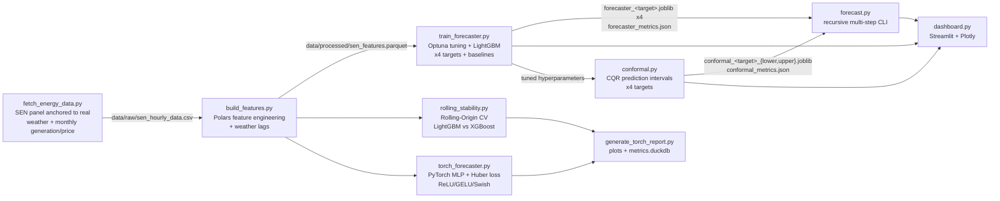

# ⚡ Chile Energy Grid Forecasting

[ 🇺🇸 English ] | [ 🇨🇱 [Español](README.es.md) ]


Hourly multi-target forecasting of Chile's National Electric System (SEN) — solar generation, wind generation, demand, and marginal cost (spot price) — for 5 real 220kV nodes, on an hourly panel anchored to real weather (Open-Meteo/ERA5), real monthly SEN generation and the real Crucero marginal cost, with LightGBM models tuned via Optuna, validated walk-forward against naive/seasonal baselines, real weather-driven features (solar irradiance, wind speed, temperature) closing the causal gap between weather and renewable output, a Rolling-Origin CV stability comparison against XGBoost, a recursive multi-step-ahead forecasting engine, and a Streamlit monitoring dashboard.

## 1. Business context

Chile's SEN is dominated by renewables in its northern nodes (some of the highest solar irradiance in the world, in the Atacama Desert) and increasingly by wind in the south. This creates a real, well-documented market dynamic: high renewable output at a node pushes its marginal cost toward zero by displacing expensive thermal generation, while a demand spike with low renewable output pushes it sharply upward. Forecasting generation, demand, and price ahead of time — at the node level, not just system-wide — is what lets a generator, a large industrial consumer (mining operations are a major load in the north), or a market operator anticipate cost exposure and price-spike risk instead of reacting to it after the fact. Forecasting all four series (not just price) also matters operationally: a grid operator scheduling reserves cares about *how much* solar/wind/demand to expect, not only what it will cost.

## 1.1 Business Impact & Key Performance Indicators

| Metric | Result | What it means |
|---|---|---|
| Solar generation WAPE | **5.55%** (vs. 28.89% naive, 10.71% seasonal-naive) | Real cloud cover makes solar harder than the old simulator's, but the diurnal structure still gives LightGBM a 2x edge over yesterday's profile |
| Demand WAPE | **2.54%** (vs. 4.98% naive) | Half the error of 1-hour persistence |
| Marginal cost WAPE | **8.77%** (vs. 11.09% naive) | Cost-exposure forecasting on prices whose monthly level is the real Crucero marginal cost |
| Marginal cost, 90% prediction interval | **88.1% empirical coverage** (conformalized) vs. 76.2% from the raw LightGBM quantiles | The raw quantiles miss one hour in four; conformalizing brings it close to nominal |
| Wind | LightGBM 22.40% vs. naive 23.29% | Real wind at these substations is light and intermittent (zero output 20-79% of hours); persistence is a hard baseline |
| Best model on price | PyTorch MLP, 7.83-8.73% WAPE vs. 10.07% for LightGBM with default parameters | Same folds and features; the network beats both tree ensembles on this target |

## 2. Data

**What is real and what is simulated.** Chile's grid coordinator (CEN) publishes hourly marginal cost by bus, but its API requires an institutional account and its website blocks automated downloads. This project therefore anchors a simulated hourly panel to every real series that *is* publicly downloadable (`src/data/real_sources.py`, cached in `data/real/` so the pipeline and tests run offline):

| Series | Source | Granularity | How it is used |
|---|---|---|---|
| Solar irradiance (GHI), wind speed at 100 m, temperature | Open-Meteo (ERA5 reanalysis) at each substation's coordinates | Hourly, real | Replaces the simulated weather; solar and wind generation are derived from it |
| SEN gross generation by technology (total, solar, wind) | datos.gob.cl (CNE), plant-level | Monthly, real | Calibrates the monthly shape of solar, wind and demand |
| Marginal cost at Crucero 220 kV | CNE monthly reports (extracted in this portfolio's SAG digital twin) | Monthly, real | Sets the monthly price level |
| Hour-to-hour demand profile, price formation, price spikes | Simulator (`src/data/fetch_energy_data.py`) | Hourly, simulated | Fills in what no public source provides |

So the weather and the seasonality are real; the hourly price and demand are simulated *around* real monthly levels. Crucero's monthly average price matches the real CNE figure to within 1% (pinned by `tests/test_real_sources.py`). `generate_energy_data(use_real=False)` still produces the original fully simulated panel.

| Node | Location | Profile | Solar cap. (MWh) | Wind cap. (MWh) | Base demand (MWh) |
|---|---|---|---|---|---|
| Crucero_220kV | María Elena, Antofagasta | Mining (near-flat, 24/7 load) | 220 | 40 | 180 |
| Cardones_220kV | Copiapó, Atacama | Mixed | 200 | 60 | 90 |
| Quillota_220kV | Quillota, Valparaíso | Urban (double peak) | 110 | 70 | 140 |
| Alto_Jahuel_220kV | Buin, Metropolitana | Urban (double peak) | 130 | 30 | 320 |
| Charrua_220kV | Cabrero, Biobío | Industrial, high wind | 70 | 140 | 150 |

How the panel is built:
- **Weather comes first, generation is derived from it.** Solar is a linear fraction of the real GHI over each node's clear-sky peak; wind goes through a turbine power curve (cut-in 3 m/s, rated 12.5 m/s) applied to the real 100 m wind speed. Real wind at Alto Jahuel, Cardones and Quillota averages about 2 m/s, below cut-in most of the time, so those nodes produce no wind 72-79% of hours, which is honest: there are no wind farms at those substations.
- **Monthly calibration.** Solar, wind and demand are multiplied by a per-month factor that turns the five-node aggregate's monthly shape into the real SEN monthly shape, keeping each node's average level.
- **Demand** uses a profile-specific hourly shape, the Chilean holiday calendar, a growth trend and a temperature (HVAC) effect, now driven by real temperature.
- **Marginal cost** is derived from residual demand (demand minus solar and wind) following merit-order logic, plus occasional supply-stress spikes, recomputed after calibration and then scaled month by month to the real Crucero marginal cost. Near-zero prices at high solar are a real phenomenon in northern Chile.

Raw data and processed features are git-ignored and regenerated on demand; only the small real series in `data/real/` are versioned (see [Getting started](#8-getting-started)).

## 3. Architecture



## 4. Methodology

**Feature engineering** (`src/features/build_features.py`, Polars, computed **per node** via `.over("node")` so panel rows from different barras never leak into each other's windows):
- Lags at 1h, 24h, and 168h (1 week) for solar, wind, demand, and price.
- **Weather lags** at 1h, 3h, 6h, and 24h for `ghi_w_m2` (solar irradiance), `wind_speed_ms`, and `temperature_c` (`add_weather_lag_features`) — shorter horizons than the target lags, because weather autocorrelates and decays faster hour-to-hour than a weekly demand pattern does, so a 168h weather lag would add little. Like the 4 targets, the *raw same-hour* weather value is excluded from the feature set (`get_feature_columns`) — only lags are used, since this project simulates historical observations, not an NWP forecast that would legitimately know future-hour weather in advance.
- Rolling mean/std over 6h and 24h windows — computed on `shift(1)` so the window never includes the row being predicted.
- Cyclical sin/cos encoding of hour-of-day and month, avoiding the artificial 23→0 / Dec→Jan jump of a raw integer.
- Calendar features: day of week, weekend flag, and legal Chilean holidays (including movable holidays like Good Friday, via the `holidays` library).

**Model, tuning & validation** (`src/models/train_forecaster.py`): one `LGBMRegressor` per target — solar, wind, demand, and price all share the exact same feature set (same-hour raw values of all 4 targets, plus the 3 raw weather variables, are always excluded; a real deployment wouldn't know current demand or generation with certainty either, only lags and rolling stats). For each target, **Optuna** (`tune_hyperparameters`) searches learning rate, tree depth/leaves, subsampling, and L1/L2 regularization over 20 trials, minimizing walk-forward WAPE on 3 folds; the best hyperparameters are then re-validated with a full 5-fold walk-forward pass for reporting.

Validation uses `TimeSeriesSplit` applied to **unique timestamps** (`src/models/validation.py`), not raw panel rows — with 5 nodes sharing each hour, splitting on row order alone could put one node's hour *t* in training while another node's hour *t-1* lands in test, which is still lookahead leakage even though the row index is "later." Splitting on the timestamp axis moves every node's data for a given time block together. Baselines (`src/models/baselines.py`) are evaluated on the exact same folds and the exact same WAPE metric, so the LightGBM-vs-baseline comparison below is apples-to-apples.

**Rolling-Origin CV** (`src/models/rolling_stability.py`, `validation.get_rolling_origin_folds`): a second, distinct validation strategy alongside the expanding walk-forward above. Each fold trains on a **fixed-size** rolling window (default 180 days) and tests on the following 14 days, sliding forward — unlike the expanding walk-forward (where each fold's training set keeps growing), every fold here sees the same amount of recent history. That isolates **temporal stability** specifically: if a model's error varies a lot fold-to-fold under a constant training-window size, that is evidence of real instability, not just "the later fold had more data." Used to compare LightGBM against **XGBoost** (previously listed in `requirements.txt` but unused anywhere in the codebase) via each model's coefficient of variation (CV = std/mean) of WAPE across folds — see §5.2.

Error is reported as **WAPE** (Weighted Absolute Percentage Error: `sum(|error|) / sum(|actual|)`) rather than MAPE, because `solar_generation_mwh` is exactly 0 every night, which would make a per-point percentage error undefined at every nighttime hour.

**Multi-step-ahead forecasting** (`src/models/forecast.py`): recursively predicts N hours ahead per node. Because all 4 targets share one feature set built only from lags/rolling stats (never same-hour values), a single feature vector per future hour is enough to predict all 4 at once — there's no need to decide "which target to forecast first." Each predicted hour is fed back into the history buffer before moving to the next, exactly as it would work in production, where the real future doesn't exist yet either.

## 5. Results

### 5.1 Walk-forward validation: LightGBM (Optuna-tuned, weather-augmented) vs. baselines

Walk-forward validation, 5 folds each, 48 shared features, LightGBM (Optuna-tuned) vs. two baselines evaluated on identical folds — **naive** (persist the value from 1h ago) and **seasonal naive** (same hour 24h ago). Bold marks the best of the three per row:

| Target | LightGBM WAPE | Naive WAPE | Seasonal WAPE | LightGBM MAE |
|---|---|---|---|---|
| Solar generation | **5.55%** | 28.89% | 10.71% | 2.01 MWh |
| Wind generation | **22.40%** | 23.29% | 82.74% | 2.17 MWh |
| Demand | **2.54%** | 4.98% | 5.67% | 4.21 MWh |
| Marginal cost | **8.77%** | 11.09% | 11.71% | $5.73/MWh |

All numbers come from running `python -m src.models.train_forecaster` end to end on the weather-anchored panel (seed 42, 87,720 rows over 5 nodes × 17,544 hours, 20 Optuna trials per target). LightGBM beats both baselines on every target.

**What changed with real weather.** With the old simulated weather, solar scored 3.64% and naive persistence beat LightGBM on wind (9.93% vs. 10.31%). With real weather, solar is harder (5.55%) because real cloud cover is less predictable than the simulator's daily cloud draw, and the seasonal baseline improves sharply (19.46% → 10.71%) because real clear-sky days in the Atacama repeat almost exactly from one day to the next. Wind flips the other way: real wind at these substations is light and often below turbine cut-in, so generation is zero for long stretches and its WAPE is large (22-23%) for every model, but LightGBM now edges persistence.

### 5.2 Isolating weather's real effect: a controlled ablation (`notebooks/02_Weather_Augmented_Rolling_CV.ipynb`)

The notebook isolates the weather features, holding hyperparameters **fixed** across a with/without comparison:

| Target | WAPE without weather | WAPE with weather | Delta |
|---|---|---|---|
| Solar generation | 5.98% | 5.69% | **+0.29 pts** |
| Wind generation | 23.24% | 22.69% | **+0.54 pts** |
| Demand | 2.56% | 2.55% | +0.01 pts |
| Marginal cost | 9.82% | 10.07% | −0.25 pts |

**With real weather, weather lags help both renewables.** Solar gains 0.29 points and wind 0.54, where the simulator gave wind nothing (+0.003). Real wind is not a deterministic function of its own past output, so lagged wind speed carries information the generation lags do not. Demand is unchanged, and price gets slightly worse with the extra features and no re-tuning, a standard effect of adding dimensionality without adjusting regularization.

### 5.3 Rolling-Origin CV: LightGBM vs. XGBoost temporal stability

8 folds, fixed 180-day training window / 14-day test window, sliding forward (`src/models/rolling_stability.py`):

| Target | LightGBM mean WAPE (CV) | XGBoost mean WAPE (CV) |
|---|---|---|
| Solar | 5.02% (0.204) | 5.14% (0.202) |
| Wind | 24.33% (0.206) | 24.81% (0.215) |
| Demand | 2.56% (0.046) | 2.60% (0.063) |
| Marginal cost | **7.58% (0.084)** | 8.39% (0.111) |

CV = coefficient of variation (std/mean) of fold WAPE; lower means more stable across time blocks. LightGBM is at least as good as XGBoost on every target, and on marginal cost it is both more accurate (7.58% vs. 8.39%) and more stable (CV 0.084 vs. 0.111, about 1.3x). With the old simulated panel the stability gap on price was 2.6x; with real monthly price levels both models face the same real swings, and the gap narrows. Solar's fold-to-fold variation (CV 0.20) is now much higher than before (0.10) for both models: real cloudy and clear weeks differ far more than simulated ones.

The Streamlit dashboard's historical panel shows real vs. forecasted price on the last fold's out-of-sample test set — genuine held-out predictions, not in-sample fit — and a separate live panel runs the actual recursive multi-step forecaster on hours that don't exist in the dataset at all.

### 5.4 A third modeling family: PyTorch MLP vs. LightGBM/XGBoost, and ReLU vs. GELU vs. Swish

`src/models/torch_forecaster.py` adds a third, architecturally distinct approach on top of the statistical baselines (§5.1) and the two tree ensembles (§5.1/§5.3): a dense MLP (two hidden layers, 64→32 units) over the exact same window-lag/rolling feature set the tree models use — same walk-forward folds (`validation.get_walk_forward_folds`), same WAPE/MAE metric, so the comparison is direct. Two things this model adds that the tree models don't have:

- **A custom Huber loss** (`torch_forecaster.huber_loss`, quadratic for small residuals, linear beyond `delta=1.0`), more robust to `marginal_cost_usd_mwh`'s supply-stress price spikes than the MSE-style objective a `LGBMRegressor`/`XGBRegressor` uses by default.
- **A controlled activation comparison** — ReLU, GELU, and Swish (`nn.SiLU`), architecture/optimizer/seed held fixed so the only thing that changes between runs is the non-linearity (`compare_activations`).

Walk-forward validation, 5 folds, target `marginal_cost_usd_mwh` (`python -m src.models.generate_torch_report`, real run, seed 42, CPU; the tree rows here use fixed default parameters, not the Optuna-tuned ones of §5.1):

| Model | WAPE | MAE | Inference latency (ms / 1k rows) |
|---|---|---|---|
| Naive (1h persistence) | 11.09% | $7.23/MWh | -- |
| Seasonal naive (24h) | 11.71% | $7.66/MWh | -- |
| LightGBM (default params) | 10.07% | $6.61/MWh | -- |
| XGBoost | 10.83% | $7.11/MWh | -- |
| MLP PyTorch — ReLU | **7.83%** | **$5.07/MWh** | 0.50 |
| MLP PyTorch — GELU | 8.73% | $5.63/MWh | 0.50 |
| MLP PyTorch — Swish (chosen on validation) | 8.39% | $5.41/MWh | 0.51 |

**The PyTorch MLP beats both tree ensembles under all three activations**, and also beats the Optuna-tuned LightGBM of §5.1 (8.77%). Swish is the activation chosen on validation loss; ReLU happens to score best on test. The gap between them (0.56 points) is a reminder that the activation choice is noisy at this scale. Metrics/predictions are persisted to `data/processed/metrics.duckdb` (table `model_comparison`) alongside the per-fold JSON detail in `torch_forecaster_metrics.json`; explanatory plots are written to `data/processed/torch_*.png`.

**Training protocol.** Inside each walk-forward fold, the last 15% of the training hours (all nodes at once) is held out as validation; the fold's test hours are not touched until evaluation. Each network trains for at least 100 epochs (at most 300), then early stopping ends the run after 20 epochs without improvement in validation loss and restores the best epoch's weights; the learning rate halves on plateaus. The full state is checkpointed every epoch (`data/checkpoints/`), so an interrupted run resumes where it stopped and the GIF script reuses the report's checkpoints instead of retraining. The activation is chosen on validation loss, not on test WAPE. Validation loss bottoms out before epoch 100 in 14 of the 15 runs, so almost every run stops right after the minimum and returns an earlier epoch's weights.

The GIF below replays the real per-epoch Huber loss for the Swish run, with a floating label tracking the current train/val value as the line advances.


### 5.5 Prediction intervals: Conformalized Quantile Regression (`src/models/conformal.py`)

§5.1–§5.4 are all point forecasts. A risk band is what you size exposure against, so this adds one: a pair of LightGBM quantile regressors (5th/95th percentile, targeting a 90% nominal interval) per target, conformalized with Conformalized Quantile Regression (Romano, Patterson & Candès, 2019) — a calibration split carved from the most recent 15% of each walk-forward fold's training set (`_split_train_calibration`). Hyperparameters are the ones Optuna already tuned for the point model, held fixed; only the loss function changes.

Every fold reports coverage **both before and after** the conformal correction:

| Target | Raw quantile coverage | Conformal coverage | Nominal | Raw width | Conformal width |
|---|---|---|---|---|---|
| Solar generation | 87.1% | 88.8% | 90% | 9.01 MWh | 9.26 MWh |
| Wind generation | 85.0% | 88.3% | 90% | 8.31 MWh | 8.37 MWh |
| Demand | 83.3% | 89.9% | 90% | 16.25 MWh | 18.80 MWh |
| Marginal cost | 76.2% | **88.1%** | 90% | 19.36 $/MWh | 29.69 $/MWh |

**The raw quantile regressors undercover on every target, worst on price (76.2%), and conformalizing closes most of the gap.** Price coverage rises from 76.2% to 88.1%, at the cost of a wider band (19.4 → 29.7 $/MWh): real monthly price swings make the price distribution harder to bound than the old simulator's, and the calibration margin has to absorb that.

**Solar's interval is still badly calibrated within the day.** On the deployed (last-fold) model, night hours (`solar_generation_mwh == 0`, 42% of rows) are covered 98.4% of the time with a mean width of 0.08 MWh, while daytime hours are covered only 68.0% of the time at a mean width of 14.4 MWh. A single scalar margin calibrated over both regimes is too wide for the one with no variance and too narrow for the one that has it — a limitation of this global-margin CQR formulation on a zero-inflated target, with real cloud cover making the daytime regime harder than before. A day/night-grouped or locally weighted calibration would be the natural fix; not implemented here.

**Quantile crossing.** The two quantile regressors are trained independently, so nothing stops them from crossing (`lower > upper`) on an individual row; it happens on 0.79% of the deployed solar model's test rows, clustered at dawn and dusk near the 0 MWh floor. `rectify_crossing` (`src/models/conformal.py`) enforces the standard fix — element-wise min/max, per Chernozhukov, Fernández-Val & Galichon (2010) — applied everywhere an interval is built or scored; `tests/test_forecast.py::test_forecast_intervals_are_never_crossed` pins the regression against `forecast_node`'s real recursive output.

`forecast.py`'s recursive forecaster and the dashboard's future-forecast panel both pick up these intervals automatically when `conformal.py` has been run (`load_interval_models`); if it hasn't, both degrade to point-only output. The interval at each recursive step is computed from that step's feature vector but never fed back into the history buffer, so it does not compound uncertainty across the horizon — a known simplification.

Run `python -m src.models.conformal` after `train_forecaster.py` (it reuses the tuned hyperparameters from `forecaster_metrics.json`).

## 6. Multi-step forecasting example

```bash
python -m src.models.forecast --horizon 12 --nodes Crucero_220kV
```

Real output (mining-profile node, forecast starting at local midnight on 2026-01-01): solar output stays at zero until dawn and ramps to 144.8 MWh by 11:00, and marginal cost falls from $61.8/MWh at midnight to $37.2/MWh at 11:00 as rising solar displaces expensive generation — the merit-order dynamic, recovered from the model's own recursive predictions. Wind decays from 16.3 to about 5 MWh over the night, following its recent lags.

**A limitation the recursive forecaster's own output exposes**: `forecast.py` persists the last *known* weather values into future hours (see `forecast_node`, `last_known_weather`), because the project uses historical weather observations, not an NWP forecast for future hours. Solar still evolves correctly because its dominant driver (the cyclical hour-of-day/month encoding) is recomputed for each future timestamp, but wind only follows its own lags. A production deployment would need real NWP forecasts for the recursive horizon.

## 7. Tech stack

Python · Polars · pandas · NumPy · LightGBM (point + quantile regression) · XGBoost · **PyTorch** (MLP, custom Huber loss, ReLU/GELU/Swish) · **Conformalized Quantile Regression** (prediction intervals) · **DuckDB** (comparative metrics store) · Optuna · scikit-learn (`TimeSeriesSplit`) · Streamlit · Plotly · `holidays` · Jupyter/matplotlib (2 notebooks) · pytest (53 tests: feature-leakage checks, weather-lag correctness, fold-splitting invariants for both walk-forward and Rolling-Origin CV, baseline correctness, end-to-end recursive-forecast validation, conformal coverage/crossing/calibration-split invariants, dashboard smoke test via `streamlit.testing.v1.AppTest`, PyTorch MLP/Huber-loss/activation-comparison tests, DuckDB metrics-store round-trip)

## 8. Getting started

```bash
python -m venv venv
venv\Scripts\activate          # Windows
pip install -r requirements.txt

python -m src.data.fetch_energy_data      # build the SEN panel from the real series in data/real/ (targets + weather)
# python -m src.data.real_sources         # optional: re-download the real series (Open-Meteo, datos.gob.cl)
python -m src.features.build_features     # build lag/rolling/cyclical/weather features
python -m src.models.train_forecaster      # Optuna tuning + walk-forward train/validate, all 4 targets
# optional: --trials N (default 20) --splits N (default 5)

python -m src.models.rolling_stability     # Rolling-Origin CV, LightGBM vs XGBoost, all 4 targets

python -m src.models.generate_torch_report  # PyTorch MLP (Huber loss, ReLU/GELU/Swish) vs LightGBM/XGBoost
                                             # -> plots + data/processed/metrics.duckdb

python -m src.models.conformal              # CQR prediction intervals, all 4 targets (needs train_forecaster first)
# optional: --splits N (default 5)

python -m src.models.forecast --horizon 24 --nodes all   # recursive N-hour-ahead forecast (CLI)
                                                           # adds <target>_lower/_upper columns if conformal.py ran
streamlit run src/app/dashboard.py                        # launch the monitoring dashboard

python -m pytest tests/ -v                                 # run the test suite

jupyter nbconvert --to notebook --execute --inplace notebooks/01_eda_seasonality_analysis.ipynb
jupyter nbconvert --to notebook --execute --inplace notebooks/02_Weather_Augmented_Rolling_CV.ipynb
```

## 9. Project structure

```
src/
  data/       fetch_energy_data.py    SEN hourly panel anchored to real data (simulator kept as use_real=False)
              real_sources.py         real weather (Open-Meteo), monthly SEN generation, Crucero marginal cost
  features/   build_features.py       Polars lag/rolling/cyclical/calendar/weather-lag features
  models/     validation.py           walk-forward folds + Rolling-Origin folds + WAPE metric
              baselines.py            naive / seasonal-naive reference metrics
              train_forecaster.py     Optuna tuning + LightGBM, 4 targets
              rolling_stability.py    Rolling-Origin CV, LightGBM vs XGBoost temporal stability
              torch_forecaster.py     PyTorch MLP, custom Huber loss, ReLU/GELU/Swish comparison
              torch_plots.py          predicted-vs-actual / residuals / loss-curve / activation plots
              metrics_db.py           DuckDB comparative metrics store (model_comparison table)
              generate_torch_report.py  orchestrates MLP training + plots + DuckDB persistence
              conformal.py            CQR prediction intervals (quantile regressors + calibration), 4 targets
              forecast.py             recursive multi-step-ahead CLI, with optional prediction intervals
  app/        dashboard.py            Streamlit monitoring + live-forecast dashboard, with interval band
notebooks/    01_eda_seasonality_analysis.ipynb       EDA: diurnal/monthly seasonality, per-node demand
                                                       profiles, duck curve, weather-target correlations,
                                                       autocorrelation at the lags build_features.py uses
              02_Weather_Augmented_Rolling_CV.ipynb   weather-feature ablation + stability analysis
tests/                                pytest: features, validation, baselines, forecast, dashboard,
                                       rolling stability, feature-column exclusion, conformal coverage/
                                       crossing/calibration-split, PyTorch MLP/loss/activations,
                                       DuckDB metrics store
```

## 10. Author

**Pablo Reyes** — [github.com/Rxyxs](https://github.com/Rxyxs)
Code: MIT — see [LICENSE](LICENSE)
