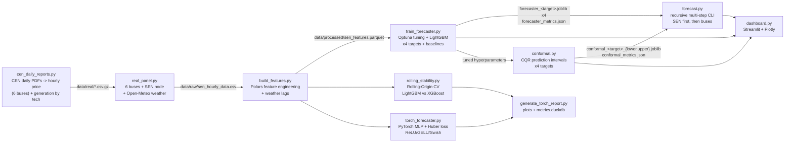

# ⚡ Chile Energy Grid Forecasting

[English ] | [[Español](README.es.md) ]


Hourly forecasting of Chile's National Electric System (SEN) on **four years of real hourly data (2022-2025)**: marginal cost at 6 real 220 kV buses from Antofagasta to Puerto Montt, and system-wide solar generation, wind generation and demand. The hourly series are not downloaded from an API (the grid coordinator's requires an institutional account): they are read out of the vector charts in the coordinator's public daily PDF reports, calibrated day by day against the numbers each report prints, and validated against two independent official monthly series. On top of that: LightGBM tuned with Optuna and validated walk-forward against naive baselines, real weather features (ERA5), Rolling-Origin CV against XGBoost, a PyTorch MLP, conformal prediction intervals, a recursive multi-step forecaster and a Streamlit dashboard.

## 1. Business context

Chile's SEN is a 3,000 km line. The north (Atacama) has some of the highest solar irradiance in the world; the south has hydro and wind; transmission between them is limited. That creates a real, well-documented market dynamic: at noon, solar surplus in the north pushes the marginal cost there to zero while buses further south keep paying for thermal and hydro, and in the evening the price everywhere jumps when the sun sets. Forecasting the price **per bus** — not one system price — is what lets a generator, a large industrial consumer (mining is a major load in the north) or a trader anticipate cost exposure. Forecasting system solar, wind and demand matters on its own for reserve scheduling, and it feeds the price model.

## 1.1 Key results

| Metric | Result | What it means |
|---|---|---|
| Hourly series reconstructed from PDF charts | **1,394 days** with all 6 buses; median calibration residual **0.04 USD/MWh** | Each day's chart is calibrated against the daily averages printed in the same report |
| Demand (system) WAPE | **1.20%** vs. 2.50% naive | Half the error of 1-hour persistence |
| Solar (system) WAPE | **6.21%** vs. 22.03% naive, 11.22% same hour yesterday | Weather and the hour of day carry most of it |
| Wind (system) WAPE | **9.05%** vs. 11.80% naive | Persistence is a hard baseline for wind |
| Marginal cost, 6 buses, WAPE | **18.84%** vs. 21.87% naive | Real prices are far harder than the old simulated panel's (8.77%) |
| Marginal cost at Puerto Montt | LightGBM **22.91%** vs. **20.81%** naive | The one bus where the model loses to persistence: it is decoupled from the system's residual demand |
| PyTorch MLP on price | 21.74% (Swish) vs. 18.84% tuned LightGBM | On the simulated panel the MLP won; on real prices it barely matches persistence |
| Price, 90% conformal interval | **88.8%** coverage vs. 85.6% raw quantiles | Close to nominal |

## 2. Data: four years of real hourly data, read out of PDF charts

Chile's grid coordinator (CEN) publishes hourly marginal cost by bus and hourly generation by technology, but its API requires an institutional account and its data portal blocks automated downloads. It also publishes, every day and without an account, a PDF called *Resumen Ejecutivo de Operación* (daily operation summary). Its charts are **vector drawings, not images**: each line and stacked area is stored as the exact coordinates the chart was drawn from. `src/data/cen_daily_reports.py` downloads the reports for 2022-2025 (1,413 of 1,461 days are online) and reads two hourly series out of them:

| Series | Source | Granularity | Used as |
|---|---|---|---|
| Marginal cost at Crucero, Cardones, Pan de Azúcar, Quillota, Charrúa and Puerto Montt 220 kV | Report chart "Costo Marginal Real Preliminar": one 24-point line per bus. During July-August 2025 the reports switch to the *online* marginal cost, a 96-point line per bus (every 15 minutes), averaged to hours | Hourly, real | Price target, per bus |
| Generation by technology: thermal, hydro, solar, wind, batteries | Report chart "Generación horaria bruta por tecnología": stacked areas | Hourly, real | Solar and wind targets; their sum (gross generation) is the demand target |
| Solar irradiance (GHI), wind speed at 100 m, temperature | Open-Meteo (ERA5 reanalysis) at each bus's coordinates | Hourly, real | Weather features |

**Calibration.** Neither chart has a reliable explicit scale (the gridlines are snapped to pixels), so each day is calibrated against numbers the same report prints as text:

- The marginal-cost legend prints each bus's **daily average**. With 6 to 8 buses and a 2-parameter line (pixels → USD/MWh), the fit is overdetermined, so its residual measures the reconstruction. Median worst-bus residual: **0.04 USD/MWh**; 99th percentile: 0.23 (the printed averages are rounded to 0.1).
- The generation table prints each technology's **daily energy** (GWh). A single scale (MW per point) has to reproduce all four large technologies at once: median worst-technology error **0.06%**, 95th percentile 2.5%. The hourly shape comes from the chart; each technology is then matched to its own daily energy (batteries, 1-2% of the energy, are drawn inconsistently and are matched but not used to calibrate).

Getting there meant handling five report formats: the bus legend changed names and layout, early-2022 reports draw wind as a bare line on top of the stack, some areas come as several sub-paths in one drawing (battery discharge in the morning and the evening, with a gap at noon), the PDF drops collinear vertices on flat stretches, and late-2025 reports smooth the areas with Bézier curves. `tests/test_cen_daily_reports.py` pins those cases on synthetic inputs.

**Validation against independent sources.** Two public monthly series were not used to build anything, so they can check it:


- **Monthly energy vs. the official SEN generation (datos.gob.cl):** total within 3% (usually 1-2%), wind within 5%. Solar from the charts is consistently 2-8% *below* the official series: the two sources do not count exactly the same plants.
- **Crucero's monthly marginal cost vs. the CNE monthly reports:** from June 2022 to June 2024 the mean of the reconstructed hours matches the CNE figure to within about 0.5 USD/MWh. **From July 2024 the two publications diverge**: the daily report is 9-30 USD/MWh lower than the CNE figure every month. The reconstruction still reproduces the daily value the report itself prints on another page (45.34 vs. 45.33 on 10 July 2024, 64.00 vs. 63.98 on 15 October 2024), so the difference is between the two publications, not in the extraction. These files cannot tell which one changed definition; the price target here is the daily report's.

**What the panel looks like.** No public source has generation or demand *per bus*, so the panel does not invent them: alongside the 6 buses it has a 7th node, `SEN`, that carries the system-wide targets (solar, wind, demand) with the average weather of the 6 buses. Bus rows also carry the system series, so their lags feed the price model (merit order depends on the system's residual demand, not the bus's). `real_panel.rows_for_target` decides which rows train and score each target: the `SEN` node for solar, wind and demand, the 6 buses for price, so no metric counts the same system hour seven times.

**Cleaning.** Hours where total generation falls below half of that day's median are marked missing (the hour that does not exist on the day daylight saving starts, which the chart draws as 0, and the national blackout of 25 February 2025). Days without a report or without a usable chart stay missing, not interpolated: 95.8% of hours have system data and 95.9% have prices. The PDFs themselves (about 1 GB) are not versioned; the extracted hourly series in `data/real/` are.

`generate_energy_data(use_real=False)` still produces the original fully simulated panel (5 buses, 2024-2025), kept for tests that need a known generating process.


**The price splits by geography at noon.** Between 10:00 and 16:00, Crucero, Cardones and Pan de Azúcar sit below 1 USD/MWh in 70-74% of hours (solar surplus in the north), Quillota and Charrúa in 53-56%, and Puerto Montt in only 29%. The system's residual demand correlates 0.64-0.73 with the price at five buses and 0.19 at Puerto Montt (`notebooks/01_eda_seasonality_analysis.ipynb`): one system-wide driver does not price a bus that transmission isolates.

## 3. Architecture



## 4. Methodology

**Feature engineering** (`src/features/build_features.py`, Polars, computed **per node** via `.over("node")` so rows from different nodes never leak into each other's windows):
- Lags at 1h, 24h, and 168h (1 week) for solar, wind, demand and price. On bus rows, the solar/wind/demand lags are the system's: the price model sees the system's recent residual demand.
- **Weather lags** at 1h, 3h, 6h and 24h for `ghi_w_m2`, `wind_speed_ms` and `temperature_c`. The raw same-hour weather value is excluded (`get_feature_columns`): the project uses historical observations, not a numerical weather forecast that would legitimately know the future hour.
- Rolling mean/std over 6h and 24h windows, computed on `shift(1)` so the window never includes the row being predicted.
- Cyclical sin/cos encoding of hour of day and month; day of week, weekend flag and Chilean legal holidays (including movable ones, via `holidays`).

**Model, tuning & validation** (`src/models/train_forecaster.py`): one `LGBMRegressor` per target. For each target, **Optuna** searches learning rate, tree depth/leaves, subsampling and L1/L2 regularization over 20 trials, minimizing walk-forward WAPE on 3 folds; the best hyperparameters are re-validated on a 5-fold walk-forward pass for reporting. Each target trains and scores only on its own rows (`rows_for_target`).

Validation uses `TimeSeriesSplit` on **unique timestamps** (`src/models/validation.py`), not on panel rows: with 7 nodes sharing each hour, splitting on row order could put one node's hour *t* in training and another node's hour *t-1* in test. Baselines (`src/models/baselines.py`) are scored on the same folds with the same metric.

**Rolling-Origin CV** (`src/models/rolling_stability.py`): each fold trains on a **fixed-size** 180-day window and tests on the next 14 days, sliding forward, so every fold sees the same amount of history; the coefficient of variation (std/mean) of fold WAPE measures temporal stability, LightGBM vs. **XGBoost**.

Error is reported as **WAPE** (`sum(|error|) / sum(|actual|)`) rather than MAPE, because solar is exactly 0 every night and the price is exactly 0 at noon in the north for much of the year, which would make a per-point percentage undefined.

**Multi-step-ahead forecasting** (`src/models/forecast.py`): recursive, each predicted hour fed back into the history buffer before the next. On the real panel the system is forecast first (solar, wind and demand at the `SEN` node) and each bus's price is then forecast with that system path, instead of each bus guessing the country's solar from its own weather.

## 5. Results

### 5.1 Walk-forward validation: LightGBM (Optuna-tuned) vs. baselines

5 folds over 2022-2025, LightGBM (Optuna-tuned) vs. two baselines evaluated on identical folds — **naive** (the value 1h ago) and **seasonal naive** (same hour 24h ago):

| Target | LightGBM WAPE | Naive WAPE | Seasonal WAPE | LightGBM MAE |
|---|---|---|---|---|
| Solar (system) | **6.21%** | 22.03% | 11.22% | 127 MW |
| Wind (system) | **9.05%** | 11.80% | 34.59% | 111 MW |
| Demand (system) | **1.20%** | 2.50% | 4.44% | 116 MW |
| Marginal cost (6 buses) | **18.84%** | 21.87% | 38.97% | $12.52/MWh |

All numbers come from `python -m src.models.train_forecaster` end to end (seed 42, 20 Optuna trials per target). LightGBM beats both baselines on every target. The price result breaks down very differently by bus:

| Bus (north → south) | LightGBM WAPE | Naive WAPE | Seasonal WAPE | LightGBM vs. naive |
|---|---|---|---|---|
| Crucero | **17.25%** | 23.38% | 30.91% | −26% |
| Cardones | **17.47%** | 23.41% | 31.30% | −25% |
| Pan de Azúcar | **18.13%** | 23.10% | 34.26% | −21% |
| Quillota | **17.64%** | 20.73% | 36.03% | −15% |
| Charrúa | **18.74%** | 21.02% | 38.41% | −11% |
| Puerto Montt | 22.91% | **20.81%** | 57.41% | **+10%** |


**The model's edge shrinks from north to south and turns negative at Puerto Montt.** In the north, the noon price collapse is predictable from the system's solar and the hour of day, which persistence cannot see coming. Puerto Montt's price is barely related to the system's residual demand (correlation 0.19, §2), so the features that carry the other five buses do not help it, and one model shared across buses applies the northern pattern where it does not hold. A per-bus model or bus-specific drivers (regional hydro, transmission limits) would be the next step there.

**What changed against the simulated panel.** The previous version of this project forecast price at 8.77% WAPE on a panel whose hourly prices were simulated around a real monthly level. On real hourly prices the same pipeline lands at 18.84%, and its margin over persistence falls from 21% to 14%. Real prices are zero-inflated (the north at noon), regime-switching (a 2022 that averaged about 100 USD/MWh, a 2024 below 50 at five of the six buses) and geographically split; the simulator had none of that.

### 5.2 Isolating weather's effect: a controlled ablation (`notebooks/02_Weather_Augmented_Rolling_CV.ipynb`)

The notebook compares each target **with and without** the weather lags, hyperparameters **fixed** (so the comparison is not confounded with re-tuning):

| Target | WAPE without weather | WAPE with weather | Delta |
|---|---|---|---|
| Solar (system) | 6.24% | 6.22% | +0.02 pts |
| Wind (system) | 9.27% | 9.17% | **+0.10 pts** |
| Demand (system) | 1.26% | 1.24% | +0.02 pts |
| Marginal cost (6 buses) | 19.75% | 19.94% | −0.19 pts |

**On real data, lagged weather at six substations adds almost nothing.** On the simulated panel it helped solar by 0.29 points and wind by 0.54, but there the generation was computed *from* that same weather, so the weather carried information by construction. Here the targets are the whole system's output, and six points of weather are a weak proxy for it: the best single bus correlates 0.84 with system solar but only 0.43 with system wind (§2, notebook 01). Solar's own lags plus the hour of day already contain what the irradiance lags add, and the price gets slightly worse with twelve more features and no re-tuning. A real numerical weather forecast for the hours ahead, at the wind farms rather than the substations, is what would move these numbers.

### 5.3 Rolling-Origin CV: LightGBM vs. XGBoost temporal stability

8 folds, fixed 180-day training window / 14-day test window, sliding forward over the end of 2025 (`src/models/rolling_stability.py`):

| Target | LightGBM mean WAPE (CV) | XGBoost mean WAPE (CV) |
|---|---|---|
| Solar | **4.94% (0.077)** | 5.18% (0.095) |
| Wind | 9.39% (0.093) | 9.63% (0.095) |
| Demand | 1.30% (0.122) | 1.35% (0.115) |
| Marginal cost | 24.77% (0.134) | 25.01% (**0.116**) |

CV = coefficient of variation (std/mean) of fold WAPE; lower means more stable across time blocks. XGBoost's numbers move slightly between runs (25.01% vs. 25.06% on price in the notebook re-run), from its multithreaded histogram construction. LightGBM is slightly more accurate on every target, but on price XGBoost is now the more stable one (CV 0.116 vs. 0.134), the opposite of the simulated panel, where LightGBM was 2.6x more stable. With a fixed 180-day window the price error (21-30% per fold) is higher than in the expanding walk-forward of §5.1: half a year of history does not contain the price regimes that the full history does.

The Streamlit dashboard's historical panel shows real vs. forecast price on the last fold's out-of-sample test set — genuine held-out predictions, not in-sample fit — and a separate panel runs the recursive forecaster on hours that are not in the dataset.

### 5.4 A third modeling family: PyTorch MLP vs. LightGBM/XGBoost, and ReLU vs. GELU vs. Swish

`src/models/torch_forecaster.py` adds a dense MLP (two hidden layers, 64→32 units) over the same lag/rolling feature set the tree models use, on the same walk-forward folds and metric, with a **custom Huber loss** (quadratic for small residuals, linear beyond `delta=1.0`, robust to price spikes) and a controlled **ReLU / GELU / Swish** comparison (architecture, optimizer and seed fixed).

Walk-forward, 5 folds, target `marginal_cost_usd_mwh` (`python -m src.models.generate_torch_report`, seed 42, CPU; the tree rows here use fixed default parameters, not the Optuna-tuned ones of §5.1):

| Model | WAPE | MAE | Inference latency (ms / 1k rows) |
|---|---|---|---|
| Naive (1h persistence) | 21.87% | $14.38/MWh | -- |
| Seasonal naive (24h) | 38.97% | $25.51/MWh | -- |
| LightGBM (default params) | **19.94%** | **$13.18/MWh** | -- |
| XGBoost | 21.08% | $13.91/MWh | -- |
| MLP PyTorch — ReLU | 22.03% | $14.64/MWh | 0.68 |
| MLP PyTorch — GELU | 22.01% | $14.53/MWh | 0.66 |
| MLP PyTorch — Swish (chosen on validation) | 21.74% | $14.35/MWh | 0.67 |

**On real prices the MLP loses to both tree ensembles and only ties persistence.** On the simulated panel it was the best model (7.83% against 10.07% for default LightGBM); here every activation lands at 21.7-22.0%, above default LightGBM (19.94%) and the tuned one (18.84%). The three activations are within 0.3 points of each other, so the choice among them does not matter at this scale.

**Training protocol.** Inside each walk-forward fold, the last 15% of the training hours is held out as validation; the fold's test hours are not touched until evaluation. Each network trains for at least 100 epochs (at most 300), then early stopping ends the run after 20 epochs without improvement in validation loss and restores the best epoch's weights; the learning rate halves on plateaus. The full state is checkpointed every epoch (`data/checkpoints/`). **All 15 runs reach their best validation loss between epochs 8 and 21** and stop at the 100-epoch minimum: on real prices the network starts overfitting almost immediately, and the minimum-epoch rule only adds epochs that early stopping then discards. Metrics are persisted to `data/processed/metrics.duckdb` (table `model_comparison`).


### 5.5 Prediction intervals: Conformalized Quantile Regression (`src/models/conformal.py`)

A pair of LightGBM quantile regressors (5th/95th percentile, a 90% nominal interval) per target, conformalized with Conformalized Quantile Regression (Romano, Patterson & Candès, 2019) on a calibration split carved from the most recent 15% of each walk-forward fold's training set. Hyperparameters are the ones Optuna tuned for the point model; only the loss changes.

| Target | Raw quantile coverage | Conformal coverage | Nominal | Raw width | Conformal width |
|---|---|---|---|---|---|
| Solar (system) | 71.1% | 83.9% | 90% | 430 MW | 542 MW |
| Wind (system) | 81.3% | **89.5%** | 90% | 399 MW | 493 MW |
| Demand (system) | 78.0% | 87.5% | 90% | 384 MW | 486 MW |
| Marginal cost (6 buses) | 85.6% | **88.8%** | 90% | 58.3 $/MWh | 59.6 $/MWh |

**The raw quantile regressors undercover on every target, and conformalizing closes most of the gap**, to within half a point of nominal for wind and 1.2 points for price. The price band is wide (about 60 USD/MWh) because the real price can sit at zero or near 150 in the same hour depending on the day.

**Solar's interval is badly calibrated within the day.** On the deployed (last-fold) model, night hours (44% of the test rows) are covered 100% of the time with a 255 MW band they do not need, while daytime hours are covered only 71.5% of the time at 1,040 MW. A single scalar margin calibrated over both regimes is too wide for the one with no variance and too narrow for the one that has it — a limitation of global-margin CQR on a zero-inflated target. A day/night-grouped calibration would be the natural fix; not implemented here.

**Quantile crossing.** The two quantile regressors are trained independently, so nothing stops them from crossing on an individual row; `rectify_crossing` enforces the standard fix (element-wise min/max, Chernozhukov, Fernández-Val & Galichon, 2010) everywhere an interval is built or scored, and `tests/test_forecast.py::test_forecast_intervals_are_never_crossed` pins it on `forecast_node`'s recursive output.

Run `python -m src.models.conformal` after `train_forecaster.py` (it reuses the tuned hyperparameters from `forecaster_metrics.json`).

## 6. Multi-step forecasting example

```bash
python -m src.models.forecast --horizon 12 --nodes Crucero_220kV,Puerto_Montt_220kV
```

Real output, starting at local midnight on 2026-01-01 (the first hour after the data): the system forecast puts solar at 1.2 GW at 07:00 and 6.7 GW by 11:00. With that system path, **Crucero's price falls from about 52 USD/MWh at night to 1-4 USD/MWh between 08:00 and 10:00**, while **Puerto Montt's falls to 13 USD/MWh at 08:00 and is back to 35-39 by 10:00-11:00** — the north-south decoupling of §2, recovered from the model's own recursive predictions. The night-time solar forecast is not exactly zero (25-64 MW, about 1% of the peak): the model has no hard physical constraint, only a floor at 0.

**Limitation:** `forecast.py` persists the last *known* weather values into future hours (see `forecast_node`, `last_known_weather`), because the project uses historical weather observations, not a numerical weather forecast. Solar still follows the hour of day because the cyclical encoding is recomputed for each future hour, but wind only follows its own lags. A production deployment would need a real NWP forecast for the horizon.

## 7. Tech stack

Python · **PyMuPDF** (vector chart extraction from the CEN daily reports) · Polars · pandas · NumPy · LightGBM (point + quantile regression) · XGBoost · **PyTorch** (MLP, custom Huber loss, ReLU/GELU/Swish) · **Conformalized Quantile Regression** · **DuckDB** (metrics store) · Optuna · scikit-learn (`TimeSeriesSplit`) · Streamlit · Plotly · `holidays` · Jupyter/matplotlib (2 notebooks) · pytest (76 tests: chart-extraction geometry and parsing, cross-source validation of the reconstructed series, panel layout and per-target rows, feature leakage, fold-splitting invariants, baselines, recursive forecast including the system-first coupling, conformal coverage/crossing, PyTorch MLP/Huber loss, DuckDB round-trip, dashboard smoke test)

## 8. Getting started

```bash
python -m venv venv
venv\Scripts\activate          # Windows
pip install -r requirements.txt

# Optional: rebuild the real hourly series from the CEN PDFs (about 1 GB, 1-2 hours at one request per second).
# The extracted series are already versioned in data/real/.
python -m src.data.cen_daily_reports download 2022-01-01 2025-12-31
python -m src.data.cen_daily_reports extract
python -m src.data.report_figures           # validation figures in data/processed/real_*.png

python -m src.data.fetch_energy_data        # build the real panel (6 buses + SEN, weather)
python -m src.features.build_features       # lag/rolling/cyclical/weather features
python -m src.models.train_forecaster       # Optuna tuning + walk-forward, all 4 targets
python -m src.models.rolling_stability      # Rolling-Origin CV, LightGBM vs XGBoost
python -m src.models.generate_torch_report  # PyTorch MLP vs LightGBM/XGBoost -> plots + metrics.duckdb
python -m src.models.conformal              # CQR prediction intervals (needs train_forecaster first)

python -m src.models.forecast --horizon 24 --nodes all   # recursive forecast (CLI)
streamlit run src/app/dashboard.py                        # monitoring dashboard

python -m pytest tests/ -v

jupyter nbconvert --to notebook --execute --inplace notebooks/01_eda_seasonality_analysis.ipynb
jupyter nbconvert --to notebook --execute --inplace notebooks/02_Weather_Augmented_Rolling_CV.ipynb
```

## 9. Project structure

```
src/
  data/       cen_daily_reports.py    download the CEN daily PDFs; read hourly price and generation
                                       out of their vector charts, calibrated against each report's text
              real_panel.py           real panel: 6 buses + SEN node, cleaning, rows_for_target
              real_sources.py         Open-Meteo weather; official monthly series used for validation
              report_figures.py       reconstruction-vs-official and price-by-bus figures
              fetch_energy_data.py    entry point (real panel; simulator kept as use_real=False)
  features/   build_features.py       Polars lag/rolling/cyclical/calendar/weather-lag features
  models/     validation.py           walk-forward + Rolling-Origin folds, WAPE (overall and per node)
              baselines.py            naive / seasonal-naive reference metrics
              train_forecaster.py     Optuna tuning + LightGBM, 4 targets
              rolling_stability.py    Rolling-Origin CV, LightGBM vs XGBoost
              torch_forecaster.py     PyTorch MLP, Huber loss, ReLU/GELU/Swish comparison
              torch_plots.py          predicted-vs-actual / residuals / loss-curve / activation plots
              metrics_db.py           DuckDB metrics store (model_comparison table)
              generate_torch_report.py  MLP training + plots + DuckDB persistence
              conformal.py            CQR prediction intervals, 4 targets
              forecast.py             recursive multi-step CLI (system first, then buses)
  app/        dashboard.py            Streamlit monitoring + live forecast, with interval band
data/real/    cen_cmg_hourly.csv.gz, cen_generation_hourly_by_tech.csv.gz, cen_report_extraction_quality.csv,
              weather_hourly_open_meteo_bars.csv.gz, sen_generacion_mensual.csv, cne_crucero_cmg_mensual.csv
notebooks/    01_eda_seasonality_analysis.ipynb       EDA on the real panel: seasonality, price by bus,
                                                       weather vs. generation, autocorrelation at the lags used
              02_Weather_Augmented_Rolling_CV.ipynb   weather-feature ablation + stability analysis
tests/                                pytest: extraction, real sources, features, validation, baselines,
                                       forecast, conformal, rolling stability, PyTorch, DuckDB, dashboard
```

## 10. Author

**Pablo Reyes** — [github.com/Rxyxs](https://github.com/Rxyxs)
Code: MIT — see [LICENSE](LICENSE). Data: Coordinador Eléctrico Nacional daily operation reports (public), Open-Meteo (CC BY 4.0), datos.gob.cl and CNE monthly reports for validation.
